<p align="center">
  <picture>
    <source media="(prefers-color-scheme: dark)" srcset="docs/assets/v-diagram-lockup-dark.svg" />
    
  </picture>
</p>
<h3 align="center">Turn anything you want to understand, plan, or share into an interactive visual.</h3>

<p align="center">Describe an idea, a question, or a plan to your AI agent. V-Diagram turns it into one self-contained HTML file you can explore, customize, and share.</p>

<p align="center">
  <a href="#start"><strong>Quick start</strong></a> &nbsp;·&nbsp;
  <a href="#what-you-can-make"><strong>What you can make</strong></a> &nbsp;·&nbsp;
  <a href="#diagram-types"><strong>Diagram types</strong></a> &nbsp;·&nbsp;
  <a href="#explore-and-share"><strong>Explore &amp; share</strong></a> &nbsp;·&nbsp;
  <a href="#contributing"><strong>Contribute</strong></a>
</p>

<p align="center">
  <a href="./README_ZH.md"><strong>简体中文</strong></a> &nbsp;·&nbsp;
  <a href="./README_JA.md"><strong>日本語</strong></a>
</p>

<p align="center">
  <a href="https://github.com/mbnetworku/V-Diagram/stargazers"></a>
  <a href="LICENSE"></a>
  <a href="#installation-options"></a>
  <a href="CHANGELOG.md#320--2026-10-18"></a>
</p>

<p align="center">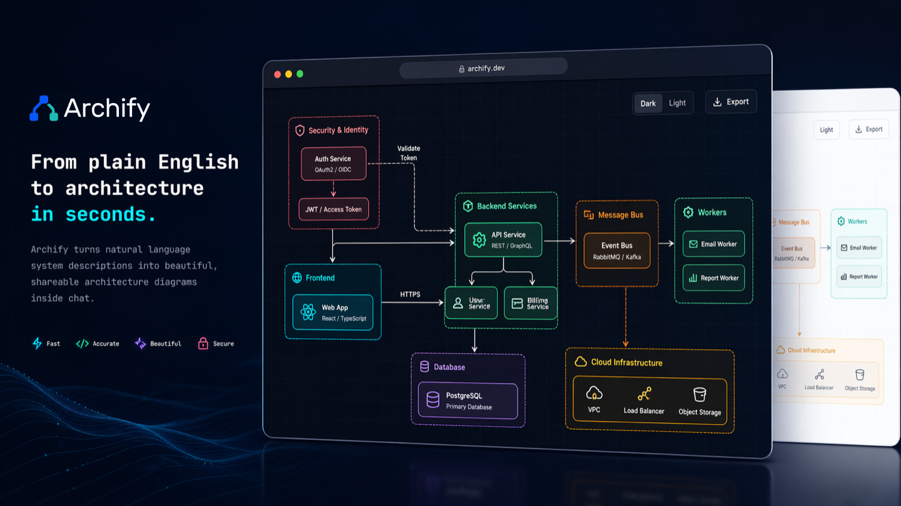</p>

## See V-Diagram in action

<!-- v-diagram-launch-video -->

https://github.com/user-attachments/assets/78570807-ba1d-4737-953f-55504a378a87

<p align="center"><sub>35-second demo: explore the diagram, follow source links, and trace a path.</sub></p>

## Why V-Diagram

| 🗺️ Understand the structure | 🧭 Walk through the story | 🧩 Extend it your way | 📤 Share the result |
|---|---|---|---|
| Map components, workflows, and relationships from code or a plain description. | Explore nodes, follow paths, and share any view as a link. | Keep an editable typed source and build on the open-source code or generated HTML. | One self-contained HTML file, or export images, video, and share cards. |

## Preview

<details>
<summary><strong>Themes, exports, and share cards</strong></summary>

<br />

| Dark | Light |
|---|---|
| 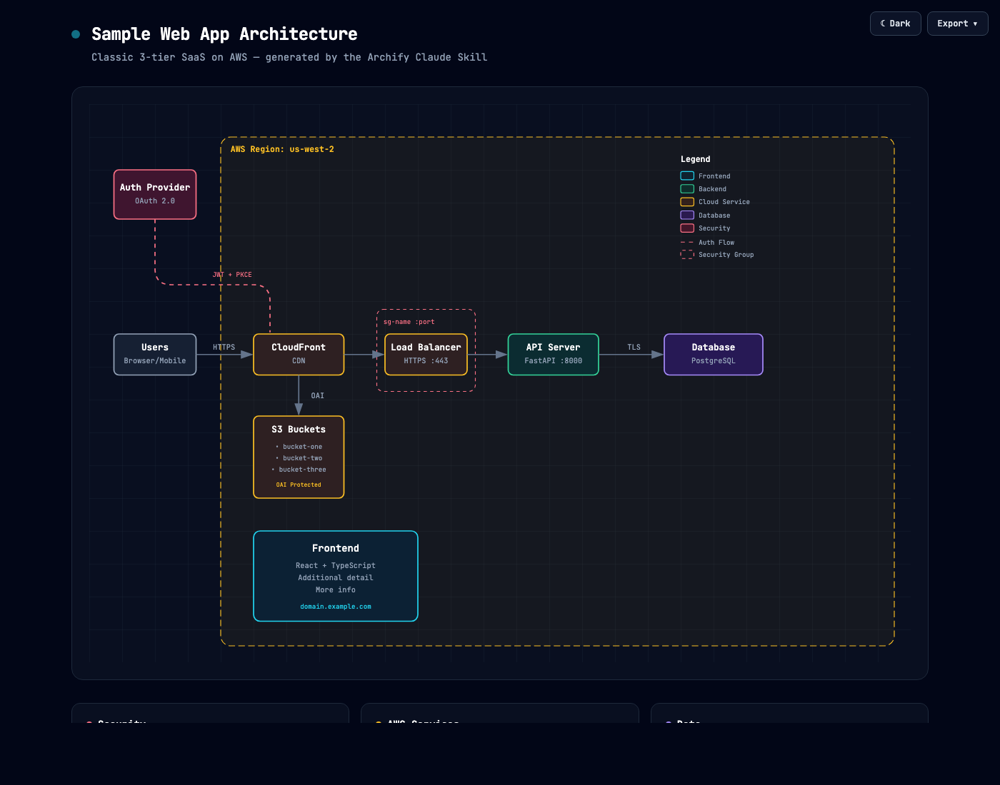 | 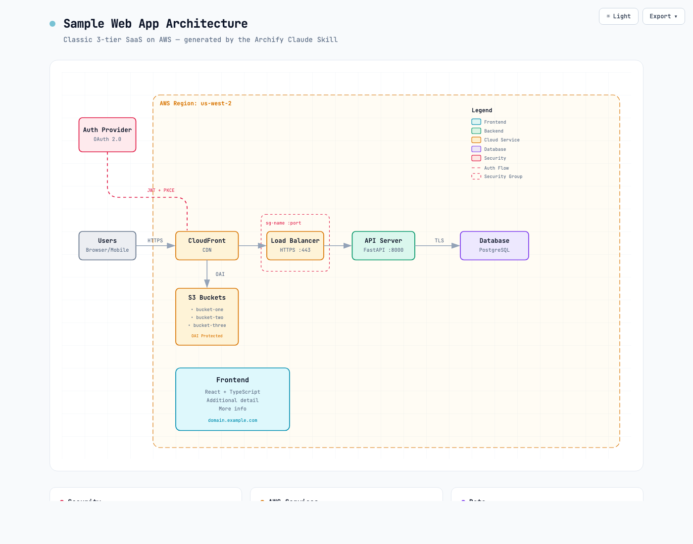 |

The Export menu copies PNG to the clipboard and downloads static or motion formats:

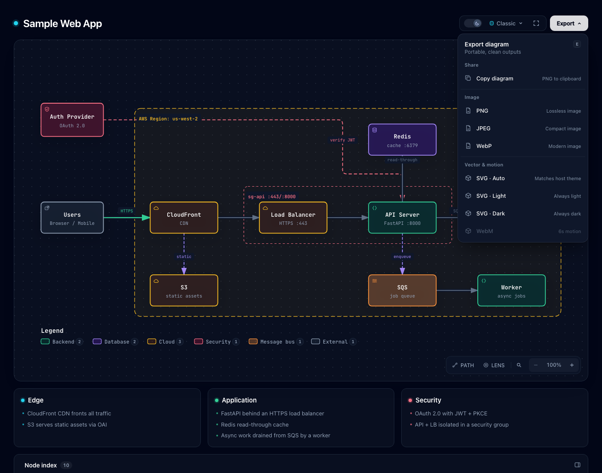

After tracing a route, **Export → Route Share Card** downloads that authored path as a 1200×630 PNG with the full diagram retained for context.

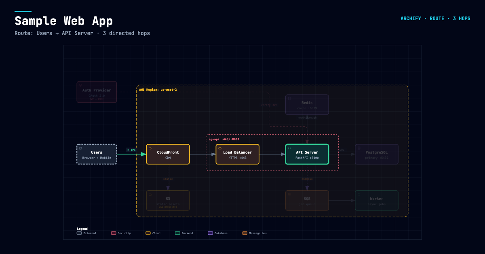

After tracing authored `Upstream` or `Downstream` reach, **Export → Reach Share Card** captures that exact reading without claiming runtime impact.

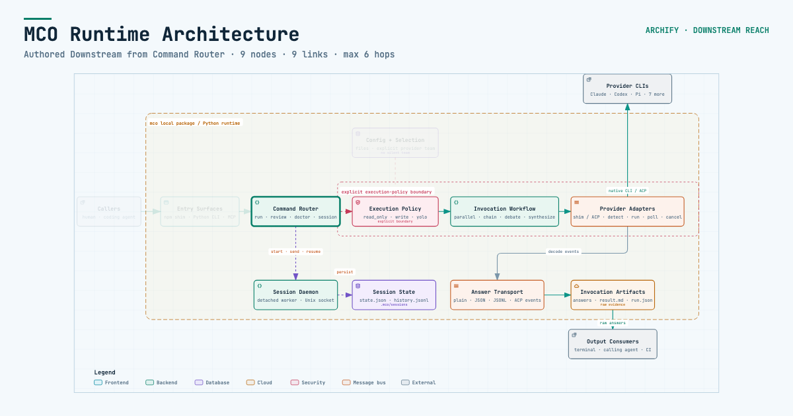

Open [`examples/web-app.html`](examples/web-app.html) locally to try the complete viewer.

</details>

---

<a id="start"></a>

## Quick start

**1. Install** (Cursor, Claude Code, Codex CLI, OpenCode):

```bash
npx skills add mbnetworku/V-Diagram -g
```

**2. Ask your agent.** No repository is required:

```text
Use V-Diagram to diagram a web request: Browser calls the API,
the API checks Redis, and a cache miss queries PostgreSQL and fills the cache.
```

**3. Refine in chat.** Try “Add authentication”, “Highlight the cache-miss path”, or “Switch to the light theme”. V-Diagram keeps the typed source so unrelated structure stays stable.

For source-backed output, open a repository and ask:

```text
Analyze this repository, then use v-diagram to create a high-level runtime architecture diagram.
Show 8–12 core components, one primary path, external dependencies, and trust boundaries.
Put supporting detail in cards instead of adding more edges.
```

<a id="quick-start"></a>

<details>
<summary><strong>Install options, update checks, and staying updated</strong> (current stable: <code>v3.2.0</code>)</summary>

<br />

Explicit, non-interactive Cursor install:

```bash
npx -y skills add mbnetworku/V-Diagram --skill v-diagram --agent cursor --global --copy --yes
```

Try without installing:

```bash
npx skills use mbnetworku/V-Diagram@v-diagram --agent codex
```

**Update checks.** V-Diagram may GET the fixed stable manifest solely to show an optional reminder; it never downloads or installs updates. Successful checks wait about 24 hours (±20%); active use retries failures after 6, then 24 hours. The server sees normal HTTP metadata (IP and time), but receives no version, Agent, project data, prompts, account/device ID, or ETag. You decide whether and when to update. Set `VDIAGRAM_UPDATE_CHECK_DISABLED=1` to disable networking and reminder-state writes.

**Stay updated.**

- **Release notifications:** select **Watch → Custom → Releases** at the top of this GitHub repository. Starring the project does not subscribe you to release notifications.
- **What changed:** [Release notes](https://github.com/mbnetworku/V-Diagram/releases) and the [Changelog](CHANGELOG.md#320--2026-10-18).
- **Feed reader:** [Subscribe to the release feed](https://github.com/mbnetworku/V-Diagram/releases.atom).

Installations with the update checker also check for newer stable releases during diagram delivery and can show a reminder. Older installations without the checker need a manual update to gain this feature. V-Diagram never installs updates automatically.

</details>

---

<a id="what-you-can-make"></a>

## What you can make

### One-page answers

Ask your agent to answer as a page and V-Diagram builds an **explainer**: the conclusion first, then one panel per question, with tables, steps, charts, code, and validated diagrams.

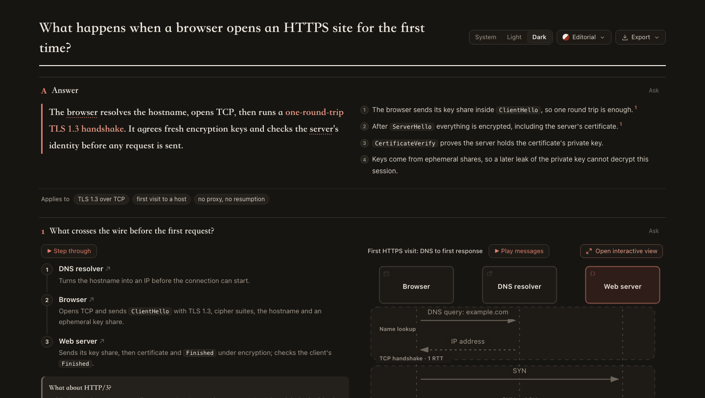

| | |
|---|---|
| **Conclusion first** | The answer and its reasons lead; every panel takes one question. |
| **Diagrams that explain** | Steps sit beside the diagram they walk through and light its parts as you read. |
| **Easy to check** | Claims cite numbered sources; repository excerpts are pinned to a commit. |
| **Easy to share** | One HTML file, four styles, light or dark. Export PNG, WebP, JPG, or PDF. |

```text
Use V-Diagram to answer as one page: our API's P99 went from 80 ms to 600 ms
while the mean barely moved. What is the likely cause, and how should we investigate?
```

### Views that show what matters

| Explain an agent workflow | Follow a cache miss | Explore service relationships |
|---|---|---|
| 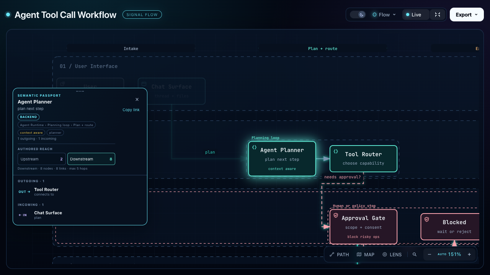 | 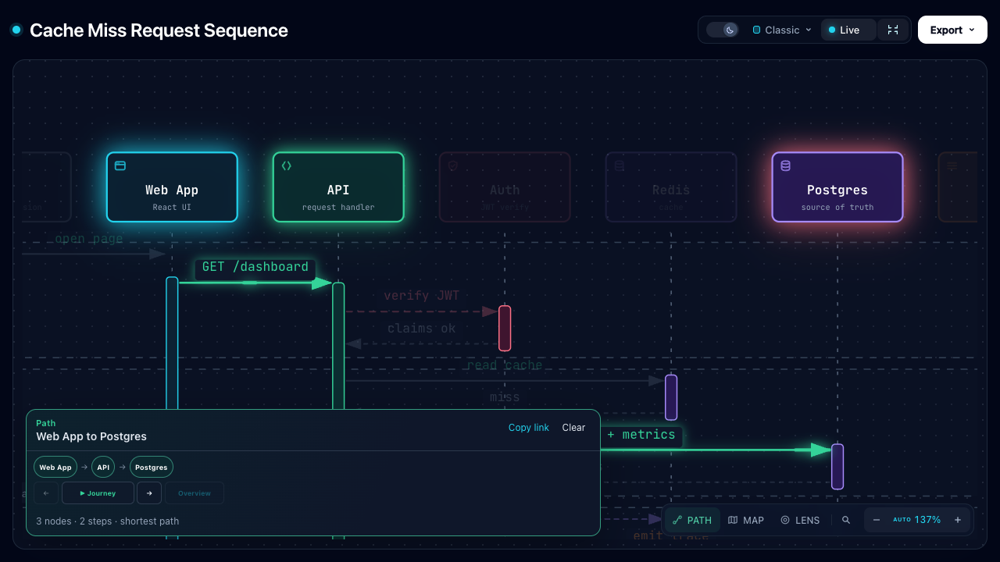 | 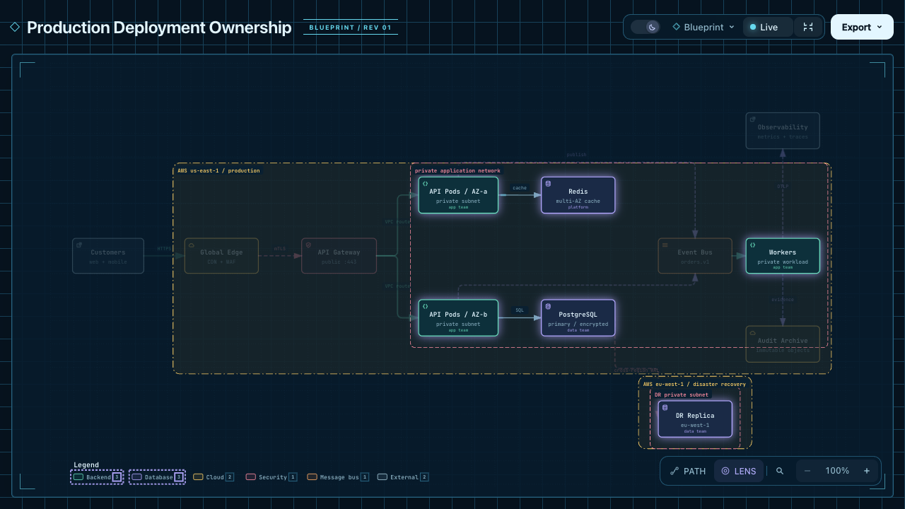 |
| Trace everything downstream of one step. | Highlight the path from web app to database. | Focus on authored backend and database connections. |

The [Proof Lab](https://mbnetworku.github.io/V-Diagram/gallery.html) contains all 11 checked-in scenarios, their JSON sources, and validation receipts.

### A real repository, mapped

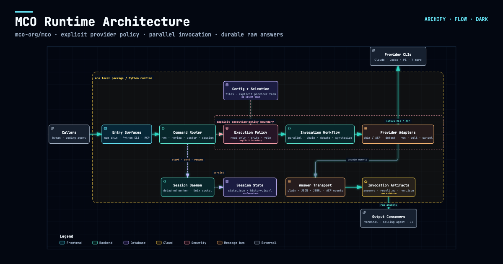

V-Diagram traced [`mco-org/mco`](https://github.com/mco-org/mco) at `9f1a1cf` and produced this checked map. Read the [typed source](docs/cases/mco-runtime.architecture.json), or open it in the [Proof Lab](https://mbnetworku.github.io/V-Diagram/cases/mco-runtime.architecture.html?theme=dark&present=1) and [trace its reach](https://mbnetworku.github.io/V-Diagram/cases/mco-runtime.architecture.html?theme=dark#focus=router&reach=downstream).

### Made your own

V-Diagram output is standalone HTML, so you can keep building after it is generated. Community creations already span team collaboration, travel planning, legal citation checks, contract review, and incident retrospectives.

One user turned a Shanghai CityWalk guide into a four-day itinerary: switch between days, inspect a stop, and jump to Amap, Xiaohongshu, or Dianping. The author added arrival check-ins and stop notes, turning it into a small tool to use during the trip.

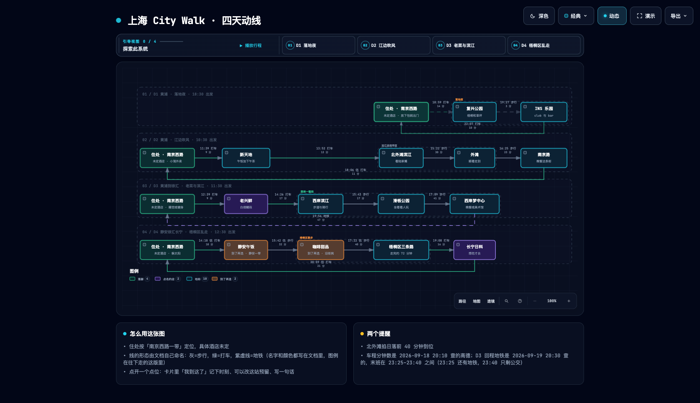

**[▶ Explore the interactive itinerary](https://mbnetworku.github.io/V-Diagram/cases/community/shanghai-citywalk.html)** · **[Download the HTML ↓](https://github.com/mbnetworku/V-Diagram/raw/refs/heads/main/docs/cases/community/shanghai-citywalk.html)**

<sub>Community artifact. Times and place information reflect the author's original itinerary. Download it and open it in a browser; no V-Diagram installation is needed. External map links need a network connection.</sub>

---

<a id="diagram-types"></a>

## Diagram types

| Type | Best for | Include in your prompt |
|---|---|---|
| **Architecture** | Components, services, storage, boundaries | Scope, core components, primary path |
| **Workflow** | CI/CD, approvals, tool calls, runbooks | Participants, order, branches, exceptions |
| **Sequence** | API calls, cache fallback, auth, async traces | Callers, callees, returns, timing |
| **Data Flow** | Pipelines, lineage, PII, consumers | Sources, transforms, stores, boundaries |
| **Lifecycle** | States, retries, waits, terminal outcomes | States, events, retry and cancellation paths |
| **ERD** | Database schemas: tables, columns, keys, cardinality | Tables, every column with its type, keys, cardinality |
| **Class** | Classes, interfaces, selected members, type relationships | Types, key members, inheritance, composition, dependencies |
| **Tree** | Single-parent hierarchies: repositories, modules, capabilities | Root, levels, what each branch contains |
| **Timeline** | When things happened: incident reviews, release histories | Timestamps with time zone, events, source lanes |
| **Waterfall** | Where the time went in one request or agent run | Spans, start times and durations, nesting |

Not sure which one fits? Use the [scenario guide](https://mbnetworku.github.io/V-Diagram/guide.html), or ask the zero-dependency CLI:

```bash
node v-diagram/bin/v-diagram.mjs guide "Show an API request with Redis cache miss"
node v-diagram/bin/v-diagram.mjs guide "Map Kafka topics, consumer groups, replay, and DLQ" --json
```

<details>
<summary><strong>See an example of every type</strong></summary>

<br />

| Workflow | Sequence | Data Flow |
|---|---|---|
| 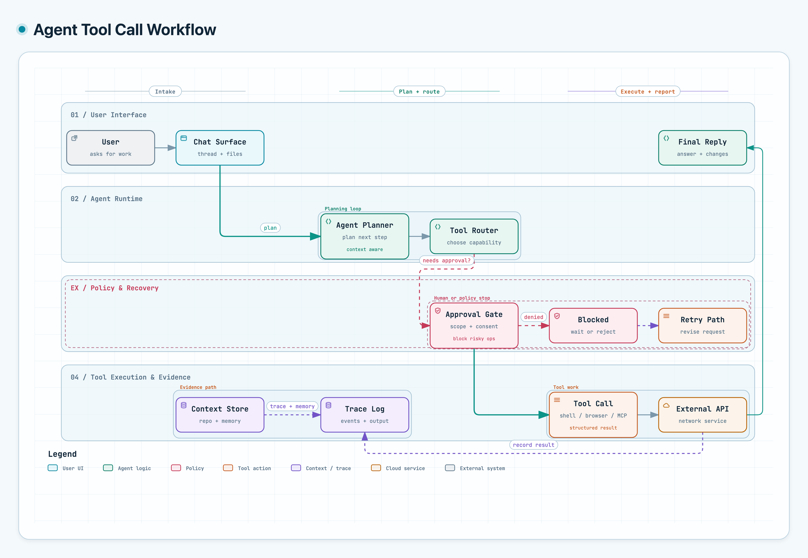 | 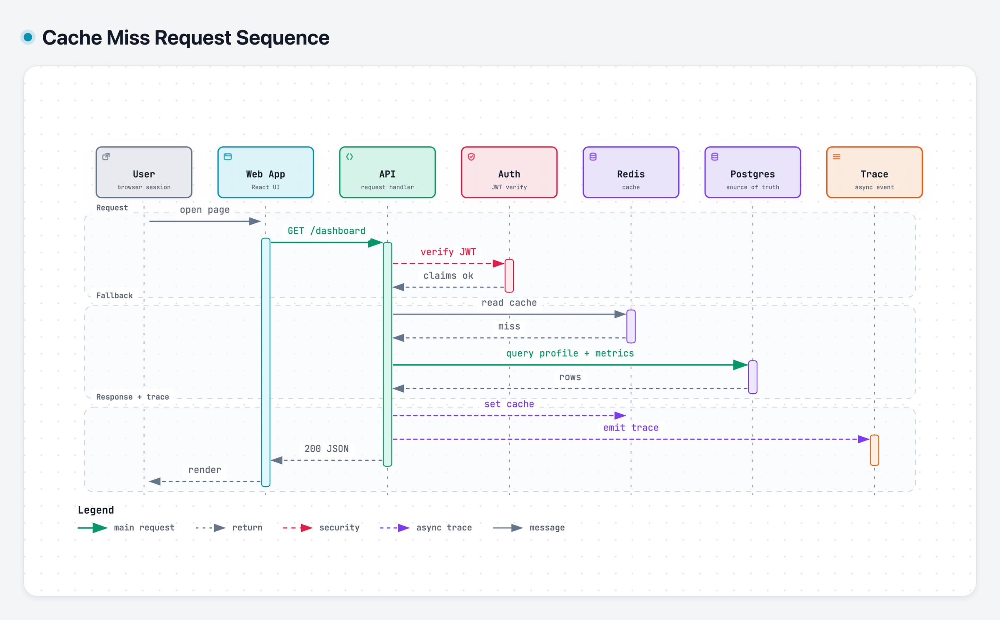 | 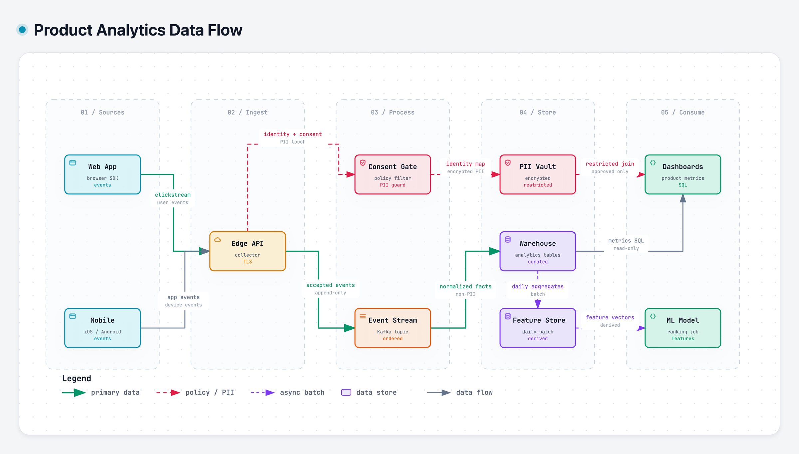 |
| Keeps the happy path clear across lanes. | Explains one interaction over time. | Makes movement and sensitivity boundaries explicit. |

| Lifecycle | ERD | Class |
|---|---|---|
| 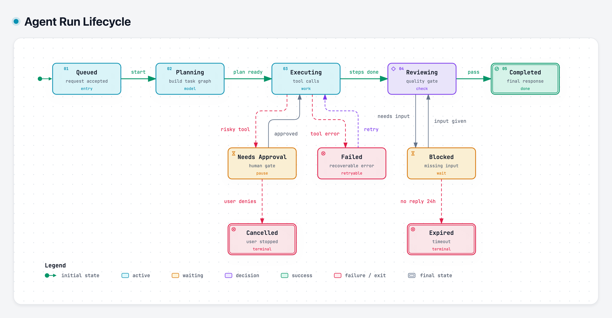 | 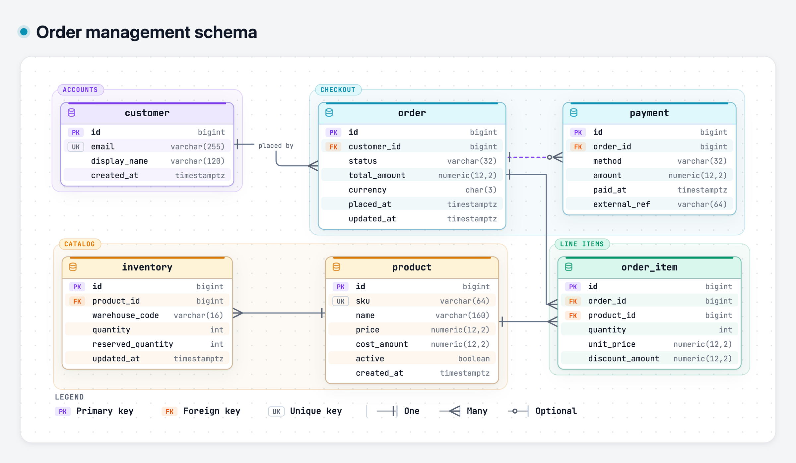 | 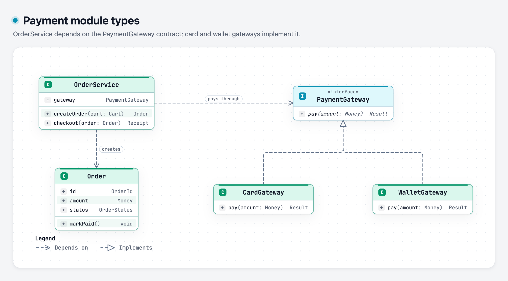 |
| Separates progress, waits, retries, and outcomes. | Keeps tables, columns, keys, and cardinality together. | Shows contracts, members, and dependencies. |

| Tree | Timeline | Waterfall |
|---|---|---|
| 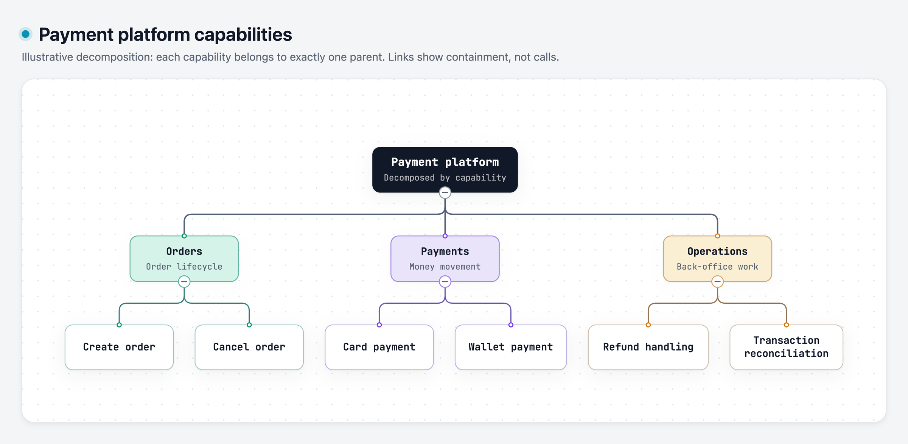 | 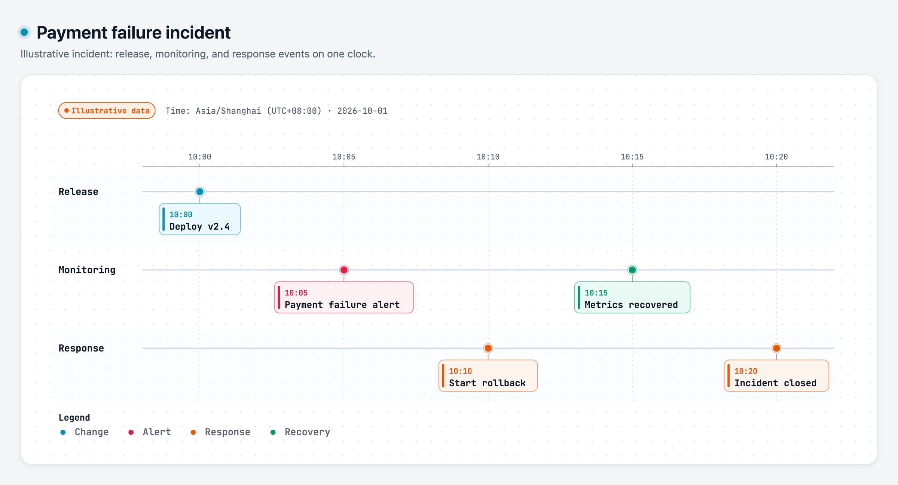 | 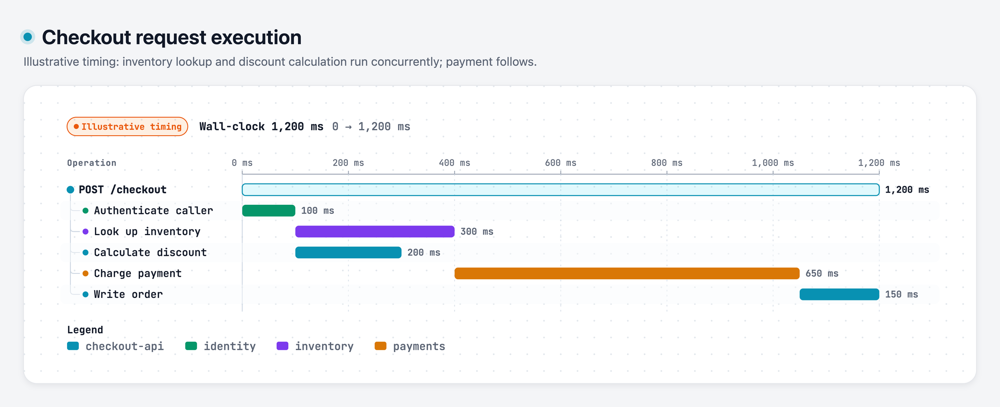 |
| Single-parent containment. | Events on one proportional clock. | Nested and overlapping spans. |

ERD, Class, Tree, Timeline, and Waterfall arrived in 3.1. Timeline and Waterfall examples use illustrative data; treat timestamps or durations as real only when they come from logs or traces.

**Open them:** [`ERD`](https://mbnetworku.github.io/V-Diagram/gallery/artifacts/orders.erd.html) · [`Class`](examples/class-payments-rendered.html) · [`Tree`](examples/tree-payment-platform-rendered.html) · [`Timeline`](examples/timeline-payment-incident-rendered.html) · [`Waterfall`](examples/waterfall-checkout-request-rendered.html)

**Architecture examples:** [`web-app`](examples/web-app.html) · [`V-Diagram pipeline`](examples/v-diagram-repo.html) · [`grid placement`](examples/v-diagram-repo-grid.html) · [`desktop agent`](examples/maka-architecture.html)

</details>

<details>
<summary><strong>Architecture profiles and review (Delta)</strong></summary>

<br />

Architecture's optional `deployment-ownership` profile fails closed when authored owners, region placement, private database scope, or named crossings are missing. It is never implicit and does not inspect live infrastructure. See the [checked deployment proof](https://mbnetworku.github.io/V-Diagram/gallery.html#proof-deployment-ownership).

For design or PR review, Architecture Delta compares validated Before / Delta / After snapshots with a machine receipt. Select an authored change or play one finite, viewer-only Review; it infers no impact, risk, or merge safety.

```bash
node v-diagram/bin/v-diagram.mjs compare architecture base.json head.json architecture-delta.html --json
```

[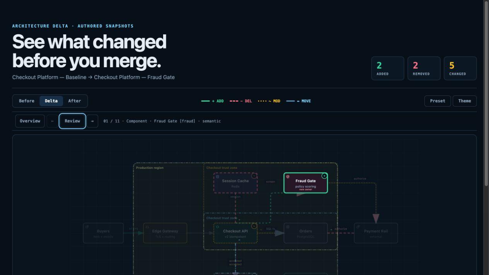](examples/checkout-platform-delta.html)

</details>

---

<a id="explore-and-share"></a>

## Explore and share

Every output is a self-contained HTML viewer. Keyboard shortcuts and controls:

| Action | Control |
|---|---|
| Open the factual Diagram Guide | <kbd>?</kbd> |
| Find and focus a semantic node | <kbd>/</kbd> |
| Trace upstream/downstream authored reach | Focus a node → `Upstream` / `Downstream` |
| Probe a directed route and inspect its journey | <kbd>R</kbd> or `PATH` |
| Compare one or two semantic roles | <kbd>L</kbd> or `LENS` |
| Open the live overview radar | <kbd>M</kbd> or `MAP` |
| Enter Presentation Stage | <kbd>F</kbd> |
| Choose visual style / toggle theme / open Export | <kbd>S</kbd> / <kbd>T</kbd> / <kbd>E</kbd> |
| Zoom or reset | <kbd>+</kbd> / <kbd>-</kbd> / <kbd>0</kbd> |

Stable links restore `#focus=<id>`, `#focus=<id>&reach=upstream|downstream`, `#relation=<id>`, `#route=<source>~<target>`, and `#lens=<kind>~<kind>`. Motion respects `prefers-reduced-motion` and never enters canonical exports.

---

## How it works

| Step | What happens |
|---|---|
| **1 · Generate** | The agent creates typed JSON IR from your description. |
| **2 · Validate** | Bundled validators and layout rules check the source; failures identify the exact local repair in machine-readable JSON. |
| **3 · Preview** *(optional)* | A loopback-only desktop session watches one source and reloads only verified revisions; failures keep the last-good artifact. |
| **4 · Deliver** | A same-directory candidate is rendered and checked; only a passing artifact atomically replaces the target. |
| **5 · Iterate** | The agent updates the source while unrelated structure stays stable. |

<details>
<summary><strong>Engineering details</strong></summary>

<br />

- **Layout judgment over generic auto-layout** — the agent chooses hierarchy, spacing, routes, and emphasis; shared automatic endpoints spread deterministically instead of piling arrows on one midpoint.
- **Typed JSON IR** — every renderer-backed mode has a schema and reproducible source.
- **Atomic validation before delivery** — schema, layout, HTML/SVG, route, and label-to-route clearance checks must all pass before a showcase artifact replaces the last known good output.
- **Failures come with a repair receipt** — `validate --json` and `deliver --json` return stable rule codes, the exact subject, measured evidence, and only supported repair controls instead of a Node stack or an unstructured retry guess.
- **Last-good live preview** — an optional desktop loop watches one JSON file, refreshes only after the latest candidate passes every gate, and keeps the previous verified diagram visible when a save is incomplete or invalid.
- **Truthful interaction** — focus, upstream/downstream reach, exact routes, role comparison, and stories reuse authored nodes and relationships instead of inventing topology or claiming runtime impact.
- **Source evidence, only when requested** — Evidence-backed Architecture nodes mark themselves `SRC n` and open Git-verified files and line ranges pinned to one public commit; ordinary artifacts stay source-free.
- **Portable by default** — the result is one HTML file; exports remain full-diagram and free of temporary viewer state.

V-Diagram is not a general-purpose drawing editor or a Mermaid theme. It turns technical intent into a communication artifact.

</details>

<details>
<summary><strong>Command-line reference and settings</strong></summary>

<br />

```bash
cd v-diagram
node bin/v-diagram.mjs doctor
node bin/v-diagram.mjs demo /tmp/v-diagram-demo
node bin/v-diagram.mjs guide "Show CI/CD checks, approval, deploy, and rollback"
node bin/v-diagram.mjs validate workflow examples/agent-tool-call.workflow.json --quality showcase --json
node bin/v-diagram.mjs preview workflow examples/agent-tool-call.workflow.json /tmp/workflow.html --quality showcase
node bin/v-diagram.mjs deliver workflow examples/agent-tool-call.workflow.json /tmp/workflow.html --quality showcase --open --json
```

`preview` is an explicit loopback-only desktop mode: it watches one JSON file on a random `127.0.0.1` port, keeps the last verified output through failures, stops with Ctrl-C, and adds no generated-HTML runtime. Use `--no-open` for tests or manual URL opening.

`deliver --open` is an opt-in one-shot handoff after commit. Opener failure preserves success; JSON remains on stdout and the absolute fallback path goes to stderr.

On failure, `validate --json` and `deliver --json` emit one JSON object. Apply only each `diagnostics[]` subject's `supportedFixes`, within the Skill's two correction rounds; visual review remains separate.

Settings:

```json
{
  "meta": {
    "locale": "en",
    "animation": "trace",
    "visual_preset": "signal-flow"
  }
}
```

`meta.locale` localizes page title, Legend, states/errors, a11y, HTML/SVG `lang`—never authored content. `en`, `zh-CN`, `zh-TW`, `es`, `ko`, and `ar` are bundled and need only `meta.locale`; `meta.translations` (canonical message key → translated string) overrides individual keys and keeps the rest of the language. Other languages supply their catalog there (see `v-diagram/examples/locales/`), or the renderer falls back to English and discloses it. Static omits `animation`; `classic` defaults.

</details>

---

<a id="installation-options"></a>

## Installation options

| Surface | Install location or method | Capability |
|---|---|---|
| **Claude Code** | `~/.claude/skills/` or `.claude/skills/` | Full renderer + validation workflow |
| **Codex CLI** | `~/.agents/skills/` or `.agents/skills/` | Full renderer + validation workflow |
| **opencode** | `~/.config/opencode/skills/`, `.opencode/skills/`, or `.agents/skills/` | Full renderer + validation workflow |
| **Claude.ai** | Upload `v-diagram.zip` under Settings → Capabilities → Skills | Depends on Node.js access in the sandbox |
| **Project Knowledge** | Upload `v-diagram.zip` to the project | Prompt-driven architecture fallback |

The [agent switcher](https://mbnetworku.github.io/V-Diagram/start.html?agent=cursor&type=architecture) generates commands for `cursor`, `codex`, `claude-code`, and `opencode`.

## Documentation

- [Skill and viewer contract](v-diagram/SKILL.md) — the complete generation and viewer reference
- [Schema reference](v-diagram/schemas/README.md) · [Examples](v-diagram/examples/) · [Agent cookbook](docs/authoring-cookbook.md)
- [Changelog](CHANGELOG.md) · [Proof Lab](https://mbnetworku.github.io/V-Diagram/gallery.html) · [Scenario guide](https://mbnetworku.github.io/V-Diagram/guide.html)

Automatic Mermaid parsing, general-purpose auto-layout, hosted sharing, and WYSIWYG editing are intentionally outside the current scope.

---

<a id="contributing"></a>

## Contributing

Issues, pull requests, and real-world diagrams are welcome. Start with the [contribution guide](CONTRIBUTING.md), use the reproducible bug form for failures, or submit a validated diagram through the [community showcase form](https://github.com/mbnetworku/V-Diagram/issues/new?template=showcase.yml).

## License

[Apache-2.0](LICENSE) — free to use, modify, and distribute.

Historical MIT grants remain in effect; see [NOTICE](NOTICE) and [LICENSE-MIT](LICENSE-MIT). Third-party components retain their own licenses. The software license does not change ownership of your authored content or grant general permission to use V-Diagram trademarks.

## Credits and disclaimer

<sub>V-Diagram is a modified version of [Archify](https://github.com/tt-a1i/archify) by tt-a1i, used under the [Apache License 2.0](LICENSE). Original copyright notices are kept in [NOTICE](NOTICE) and [LICENSE-MIT](LICENSE-MIT). V-Diagram is maintained independently and is not affiliated with or endorsed by the Archify authors.</sub>
