<p align="center">
  <picture>
    <source media="(prefers-color-scheme: dark)" srcset="docs/assets/v-diagram-lockup-dark.svg" />
    
  </picture>
</p>
<h3 align="center">理解したいこと、計画したいこと、共有したいことを、触れるビジュアルに変えます。</h3>

<p align="center">アイデア、疑問、計画を AI エージェントに説明するだけで、V-Diagram が探索・カスタマイズ・共有できる、単体で完結する HTML ファイルを生成します。</p>

<p align="center">
  <a href="#start"><strong>クイックスタート</strong></a> &nbsp;·&nbsp;
  <a href="#what-you-can-make"><strong>できること</strong></a> &nbsp;·&nbsp;
  <a href="#diagram-types"><strong>図の種類</strong></a> &nbsp;·&nbsp;
  <a href="#explore-and-share"><strong>探索と共有</strong></a> &nbsp;·&nbsp;
  <a href="#contributing"><strong>コントリビュート</strong></a>
</p>

<p align="center">
  <a href="./README.md"><strong>English</strong></a> &nbsp;·&nbsp;
  <a href="./README_ZH.md"><strong>简体中文</strong></a>
</p>

<p align="center">
  <a href="https://github.com/mbnetworku/V-Diagram/stargazers"></a>
  <a href="LICENSE"></a>
  <a href="#installation-options"></a>
  <a href="CHANGELOG.md#320--2026-10-18"></a>
</p>

<p align="center">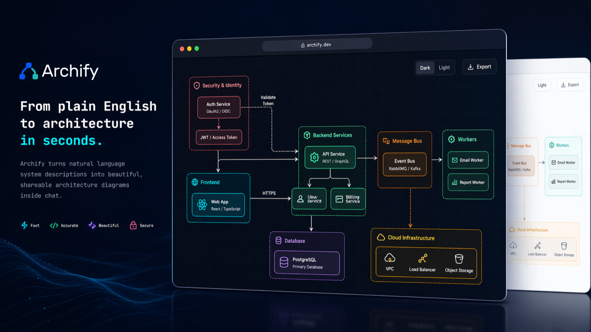</p>

## 実際の V-Diagram

<!-- v-diagram-launch-video -->

https://github.com/user-attachments/assets/78570807-ba1d-4737-953f-55504a378a87

<p align="center"><sub>約35秒の英語デモ：図の操作、ソースコードへのリンク、経路の追跡をご覧ください。</sub></p>

## V-Diagram を選ぶ理由

| 🗺️ 構造を理解する | 🧭 ストーリーをたどる | 🧩 自分のやり方で拡張する | 📤 結果を共有する |
|---|---|---|---|
| コードや説明から、コンポーネント、ワークフロー、関係を整理します。 | ノードを探索し、経路をたどり、任意のビューをリンクで共有します。 | 編集可能な型付きソースを保持したまま、オープンソースのコードや生成された HTML の上に積み上げられます。 | 単体で完結する HTML ファイルを共有するか、画像・動画・シェアカードとして書き出せます。 |

## プレビュー

<details>
<summary><strong>テーマ、エクスポート、シェアカード</strong></summary>

<br />

同じ図を 2 つのテーマで、ワンクリック切り替え:

| ダーク | ライト |
|---|---|
| 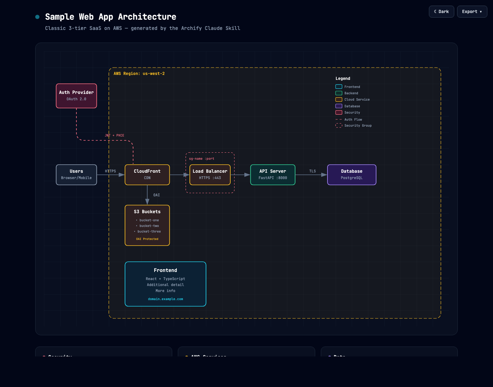 | 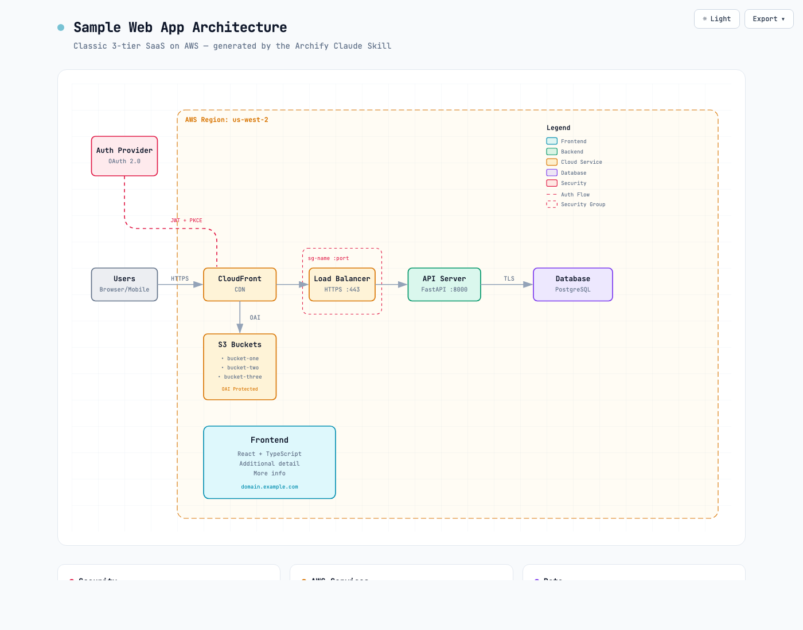 |

Export メニューから PNG をクリップボードにコピーしたり、静止画・モーション形式でダウンロードできます:

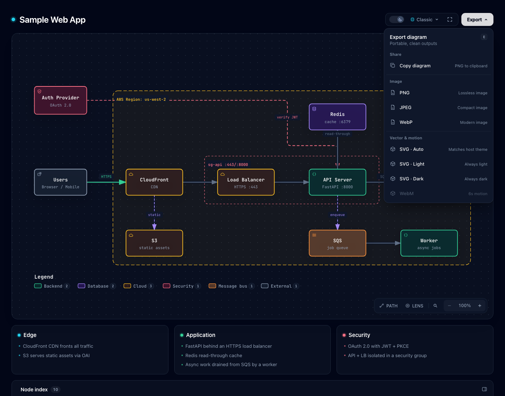

ルートをトレースしたあと、**Export → Route Share Card** を選ぶと、その記述済みパスを 1200×630 の PNG としてダウンロードできます。図全体も文脈として保持されます。

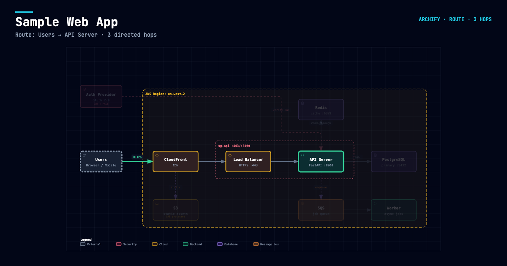

記述された `Upstream` / `Downstream` の到達範囲をトレースしたあと、**Export → Reach Share Card** はランタイム上の影響を主張することなく、その読み取り結果をそのまま切り出します。

完全なビューアを試すには、[`examples/web-app.html`](examples/web-app.html) をローカルで開いてください。

</details>

---

<a id="start"></a>

## クイックスタート

**1. インストール**（Cursor、Claude Code、Codex CLI、OpenCode）:

```bash
npx skills add mbnetworku/V-Diagram -g
```

**2. エージェントに頼む。** リポジトリは不要です:

```text
Use V-Diagram to diagram a web request: Browser calls the API,
the API checks Redis, and a cache miss queries PostgreSQL and fills the cache.
```

**3. チャットで調整する。** 「認証を追加して」「キャッシュミスの経路を強調して」「ライトテーマに切り替えて」と続けてください。V-Diagram は型付きソースを保持しているため、無関係な構造は安定したままです。

ソースを根拠にしたい場合は、リポジトリを開いてこう依頼します:

```text
Analyze this repository, then use v-diagram to create a high-level runtime architecture diagram.
Show 8–12 core components, one primary path, external dependencies, and trust boundaries.
Put supporting detail in cards instead of adding more edges.
```

<a id="quick-start"></a>

<details>
<summary><strong>その他のインストール方法、更新チェック、更新の受け取り方</strong>（現在の安定版: <code>v3.2.0</code>）</summary>

<br />

Cursor に明示的・非対話的にインストールする場合:

```bash
npx -y skills add mbnetworku/V-Diagram --skill v-diagram --agent cursor --global --copy --yes
```

インストールせずに試す場合:

```bash
npx skills use mbnetworku/V-Diagram@v-diagram --agent codex
```

**更新チェック。** V-Diagram は固定の安定版マニフェストを GET して任意の更新リマインダーを表示することがありますが、更新をダウンロードしたりインストールしたりすることはありません。チェックに成功すると次回まで約 24 時間（±20%）待機し、失敗した場合はアクティブに使用していれば 6 時間後、その後は 24 時間後に再試行します。サーバーが受け取るのは通常の HTTP メタデータ（IP と時刻）だけで、バージョン、Agent、プロジェクトデータ、プロンプト、アカウント／デバイス ID、ETag は送信されません。更新するかどうか、いつ更新するかは常にあなたが決めます。`VDIAGRAM_UPDATE_CHECK_DISABLED=1` を設定すると、ネットワーク通信とリマインダー状態の書き込みを無効化できます。

**更新の受け取り方。**

- **リリース通知:** この GitHub リポジトリ上部で **Watch → Custom → Releases** を選択します。スターを付けてもリリース通知は届きません。
- **変更内容:** [リリースノート](https://github.com/mbnetworku/V-Diagram/releases)と[変更履歴](CHANGELOG.md#320--2026-10-18)。
- **フィードリーダー:** [リリースフィードを購読する](https://github.com/mbnetworku/V-Diagram/releases.atom)。

更新チェッカー付きのインストールは、図の提供時に新しい安定版も確認し、リマインダーを表示できます。チェッカーのない古いインストールは、この機能を使うために手動で更新する必要があります。V-Diagram が更新を自動でインストールすることはありません。

</details>

---

<a id="what-you-can-make"></a>

## できること

### 1 ページで答える

エージェントに「1 ページで答えて」と頼むと、V-Diagram は **explainer** を作ります。結論を先に示し、質問ごとのパネルで、表・手順・チャート・コード・検証済みの図を使って理由を説明します。

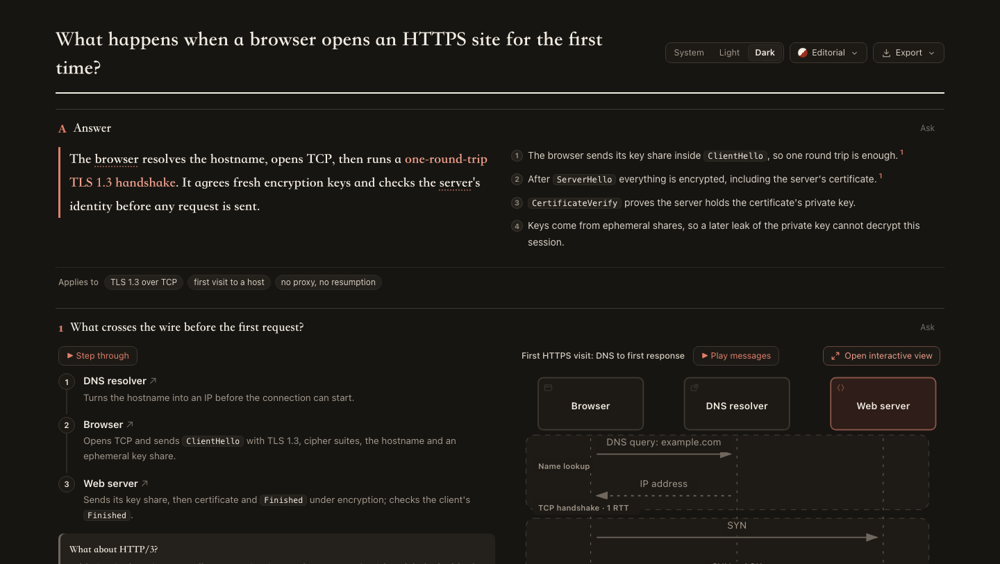

| | |
|---|---|
| **結論が先** | 答えと理由が先頭に来て、各パネルは 1 つの質問に答えます。 |
| **図と文章が連動する** | 手順は説明対象の図の横に並び、読んでいる手順に合わせて図の該当部分が光ります。 |
| **確かめられる** | 主張には番号付きの出典が付き、リポジトリの抜粋は特定のコミットに固定されます。 |
| **共有しやすい** | 1 つの HTML ファイルに 4 つのスタイルとライト／ダークテーマ。PNG・WebP・JPG・PDF で書き出せます。 |

```text
V-Diagram で 1 ページにまとめて答えて：API の P99 が 80 ms から 600 ms に上がったが、
平均はほとんど変わらない。考えられる原因と調べ方は？
```

### 伝えたいことを見せるビュー

| エージェントのワークフローを説明する | キャッシュミスを追う | サービス間の関係を調べる |
|---|---|---|
| 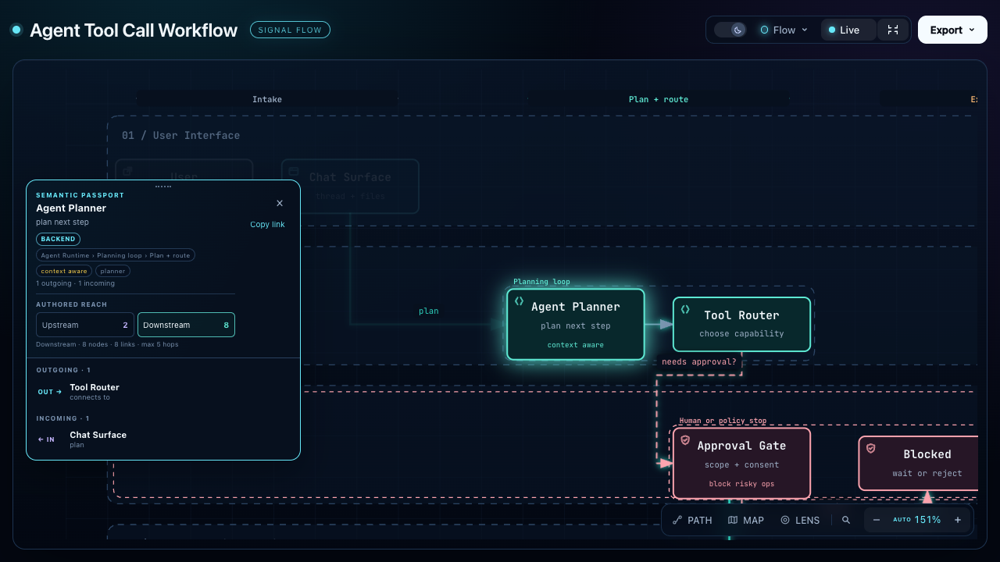 | 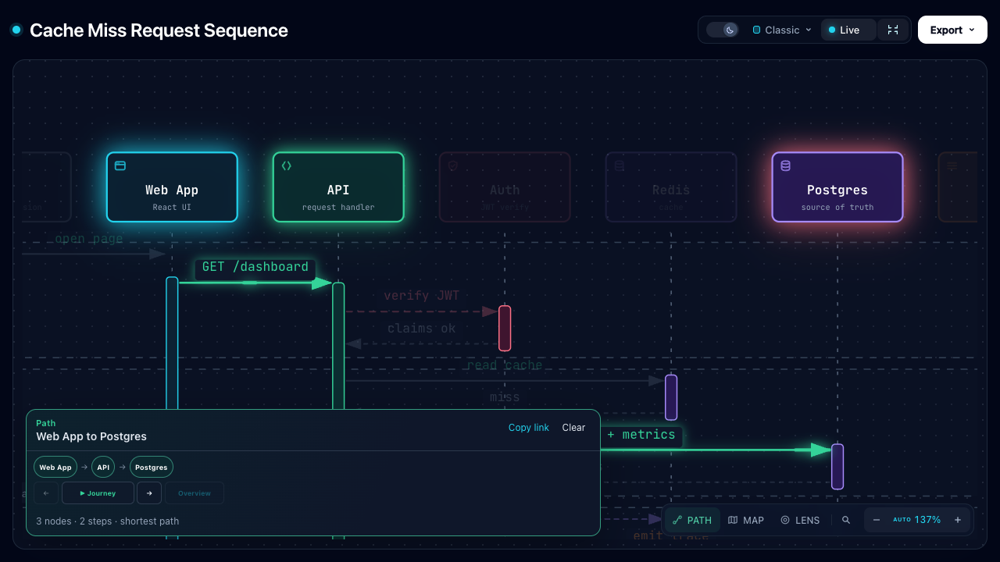 | 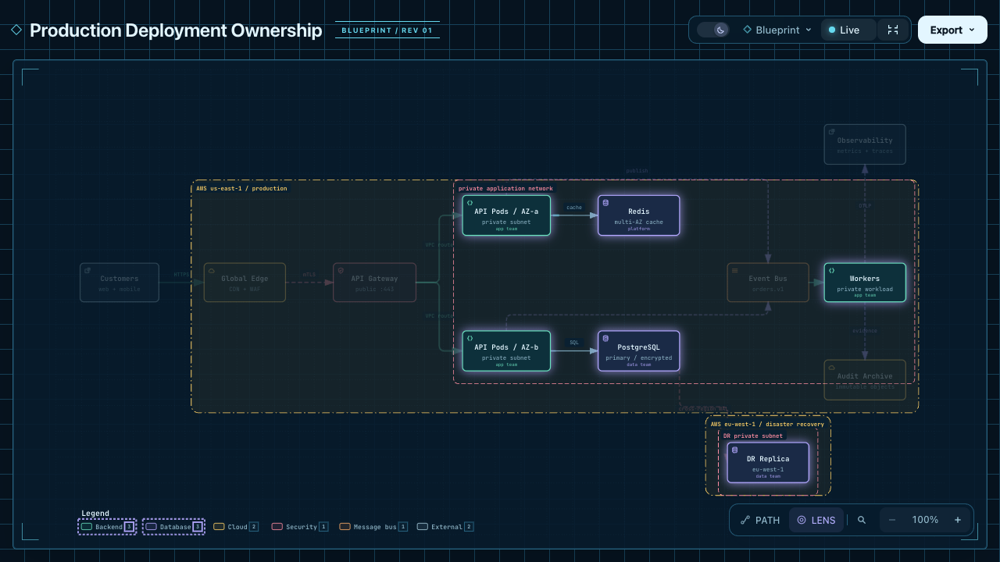 |
| 1 つのステップから下流をすべてたどります。 | Web アプリからデータベースまでの経路を強調します。 | 記述されたバックエンドとデータベースの接続に絞って見ます。 |

[Proof Lab](https://mbnetworku.github.io/V-Diagram/gallery.html) には、チェックイン済みの 11 シナリオすべてと、その JSON ソース、検証レシートが含まれています。

---

<a id="diagram-types"></a>

## 図の種類

| 種類 | 向いている対象 | プロンプトに含めるもの |
|---|---|---|
| **Architecture** | コンポーネント、サービス、ストレージ、境界 | スコープ、主要コンポーネント、主経路 |
| **Workflow** | CI/CD、承認、ツール呼び出し、ランブック | 参加者、順序、分岐、例外 |
| **Sequence** | API 呼び出し、キャッシュフォールバック、認証、非同期トレース | 呼び出し元、呼び出し先、戻り、タイミング |
| **Data Flow** | パイプライン、リネージ、PII、コンシューマ | ソース、変換、ストア、境界 |
| **Lifecycle** | 状態、リトライ、待機、終端結果 | 状態、イベント、リトライとキャンセルの経路 |
| **ERD** | データベーススキーマ: テーブル、カラム、キー、カーディナリティ | テーブル、各カラムと型、キー、カーディナリティ |
| **Class** | クラス、インターフェース、主要メンバー、型同士の関係 | 型、主要メンバー、継承、コンポジション、依存 |
| **Tree** | 親が 1 つの階層: リポジトリ、モジュール、機能の分解 | ルート、階層、各ブランチの中身 |
| **Timeline** | いつ何が起きたか: インシデントレビュー、リリース履歴 | タイムゾーン付きのタイムスタンプ、イベント、ソースレーン |
| **Waterfall** | 1 つのリクエストやエージェント実行の時間の内訳 | スパン、開始時刻と所要時間、ネスト |

どれを選べばよいか分からない場合は、[インタラクティブなシナリオガイド](https://mbnetworku.github.io/V-Diagram/guide.html)を使うか、依存関係ゼロの CLI に尋ねてください:

```bash
node v-diagram/bin/v-diagram.mjs guide "Show an API request with Redis cache miss"
node v-diagram/bin/v-diagram.mjs guide "Map Kafka topics, consumer groups, replay, and DLQ" --json
```

<details>
<summary><strong>すべての種類のサンプルを見る</strong></summary>

<br />

| Workflow | Sequence | Data Flow |
|---|---|---|
| 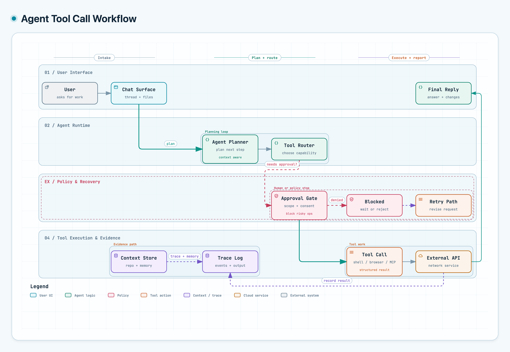 | 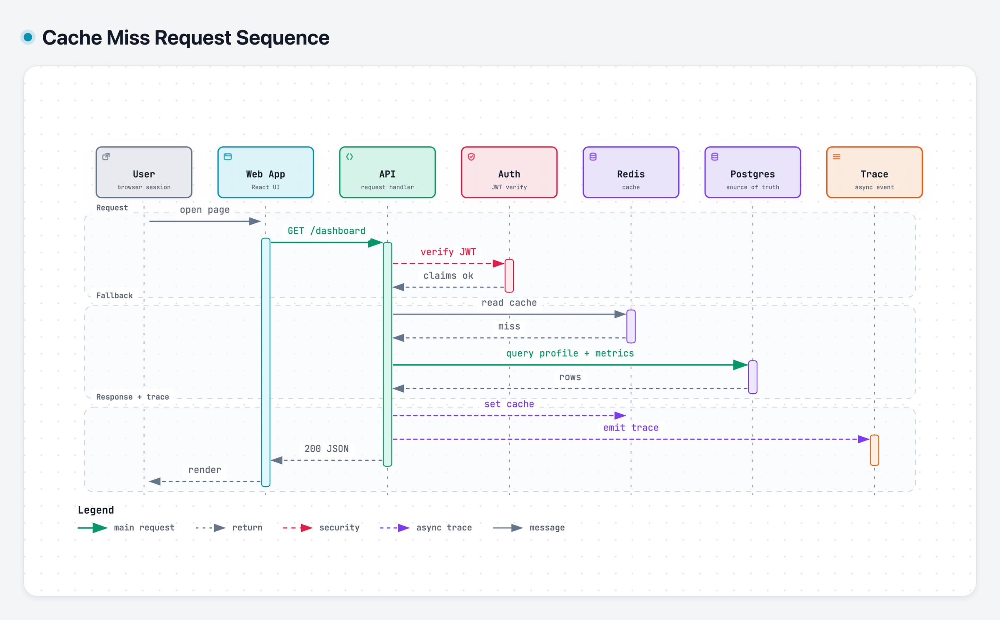 | 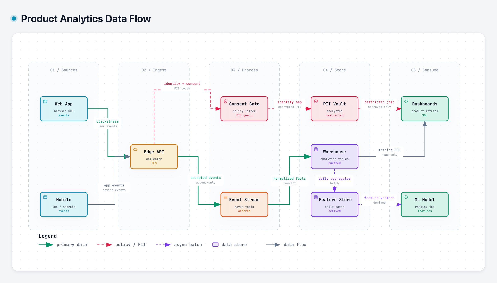 |
| レーンをまたいでもハッピーパスを明確に保ちます。 | 1 つのやり取りを時間軸で説明します。 | データの移動と機密性の境界を明示します。 |

| Lifecycle | ERD | Class |
|---|---|---|
| 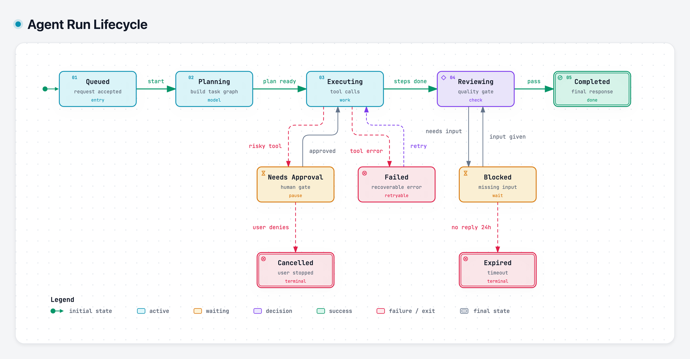 | 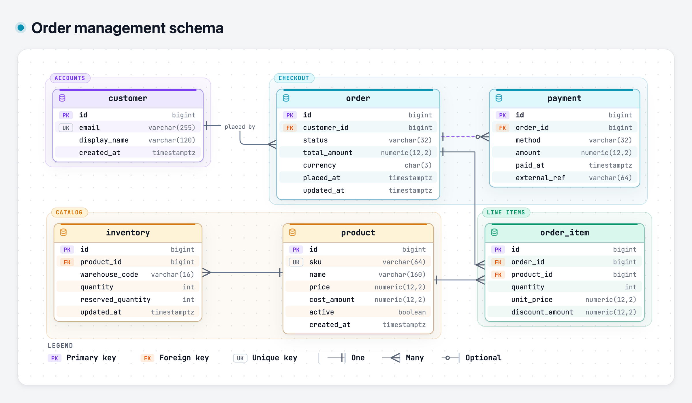 | 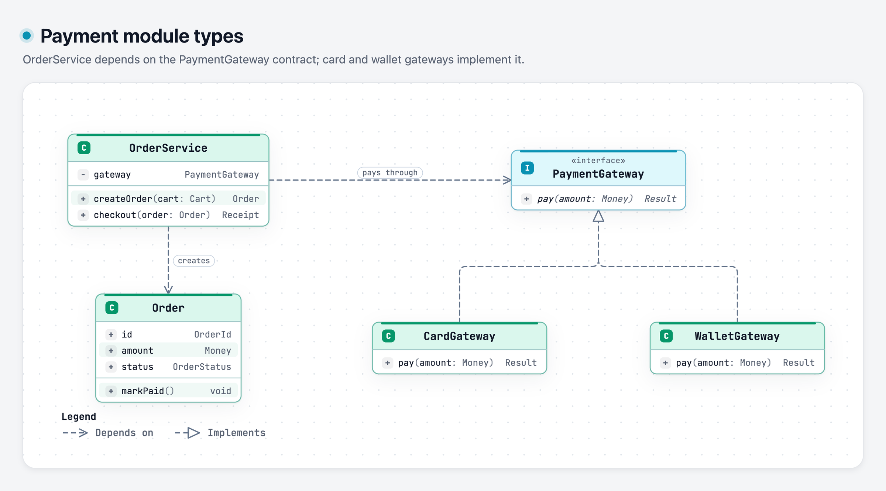 |
| 進行、待機、リトライ、終端結果を切り分けます。 | テーブル、カラム、キー、カーディナリティをまとめて示します。 | 契約、メンバー、依存関係を示します。 |

| Tree | Timeline | Waterfall |
|---|---|---|
| 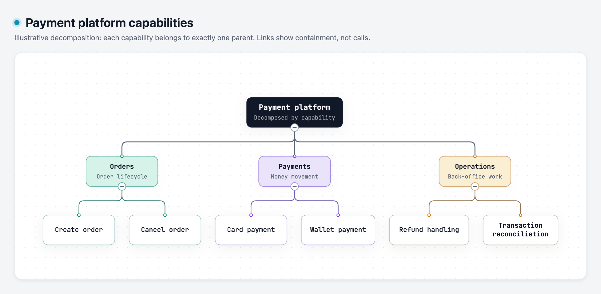 | 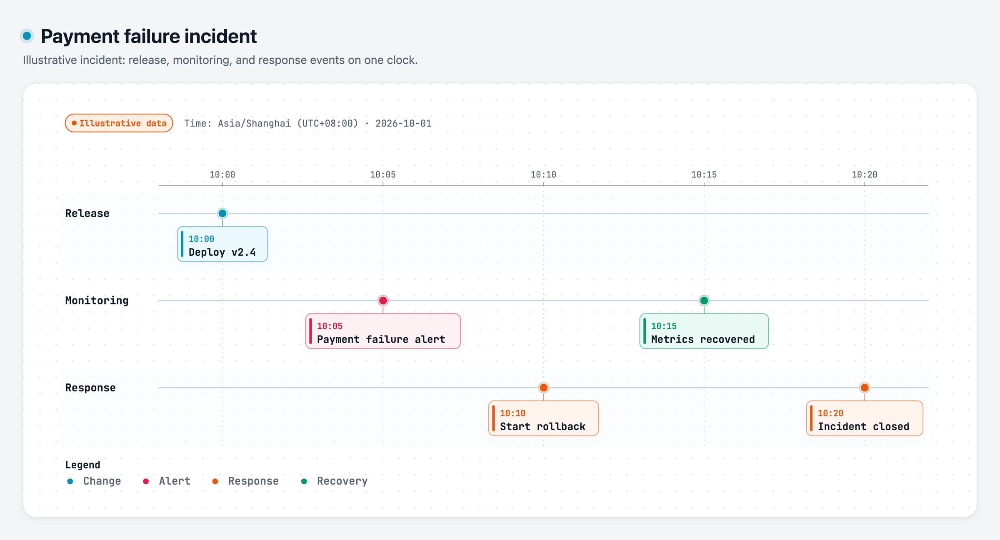 | 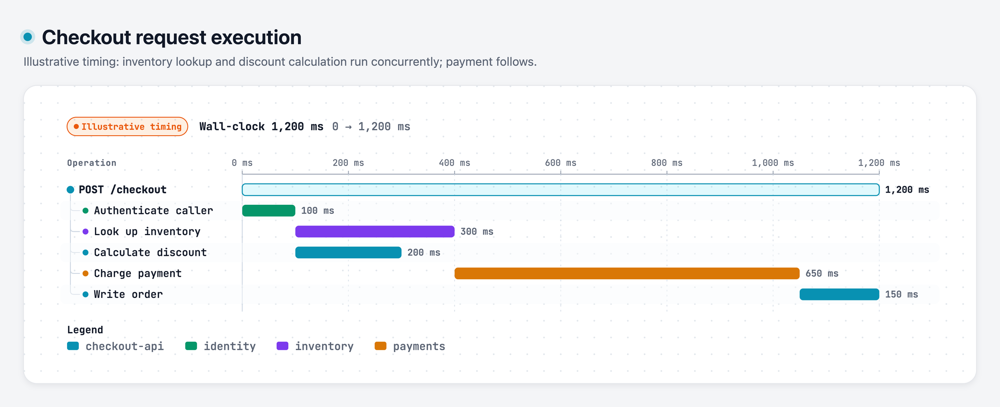 |
| 親が 1 つの包含関係。 | イベントを実時間に比例した 1 本の時間軸に配置。 | ネストや重なりのあるスパン。 |

ERD、Class、Tree、Timeline、Waterfall は 3.1 で追加されました。Timeline と Waterfall の例は説明用のデータを使用しています。ログやトレースに基づく時刻や所要時間だけを実データとして扱ってください。

**サンプルを開く:** [`ERD`](https://mbnetworku.github.io/V-Diagram/gallery/artifacts/orders.erd.html) · [`Class`](examples/class-payments-rendered.html) · [`Tree`](examples/tree-payment-platform-rendered.html) · [`Timeline`](examples/timeline-payment-incident-rendered.html) · [`Waterfall`](examples/waterfall-checkout-request-rendered.html)

**Architecture の例:** [`web-app`](examples/web-app.html) · [`V-Diagram pipeline`](examples/v-diagram-repo.html) · [`grid placement`](examples/v-diagram-repo-grid.html) · [`desktop agent`](examples/maka-architecture.html)

</details>

<details>
<summary><strong>Architecture プロファイルとレビュー（Delta）</strong></summary>

<br />

Architecture の任意プロファイル `deployment-ownership` は、記述されたオーナー、リージョン配置、データベースのプライベートスコープ、名前付きの境界越えが欠けている場合は fail-closed で停止します。暗黙的に有効化されることはなく、ライブのインフラを検査することもありません。[検証済みのデプロイ実証](https://mbnetworku.github.io/V-Diagram/gallery.html#proof-deployment-ownership)を参照してください。

設計や PR のレビューでは、Architecture Delta が検証済みの Before / Delta / After スナップショットを機械可読なレシート付きで比較します。記述された変更を選ぶか、有限でビューア専用の Review を 1 つ再生してください。影響度・リスク・マージ安全性を推測することはありません。

```bash
node v-diagram/bin/v-diagram.mjs compare architecture base.json head.json architecture-delta.html --json
```

[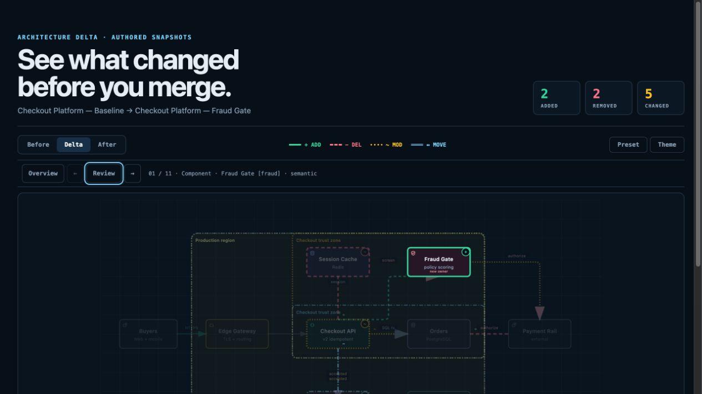](examples/checkout-platform-delta.html)

</details>

---

<a id="explore-and-share"></a>

## 探索と共有

すべての出力は、単体で完結する HTML ビューアです。ショートカットと操作:

| 操作 | ショートカット |
|---|---|
| 事実ベースの Diagram Guide を開く | <kbd>?</kbd> |
| セマンティックノードを検索してフォーカス | <kbd>/</kbd> |
| 記述された上流/下流の到達範囲をトレース | ノードをフォーカス → `Upstream` / `Downstream` |
| 有向ルートを調べて経路を確認 | <kbd>R</kbd> または `PATH` |
| 1〜2 個のセマンティックロールを比較 | <kbd>L</kbd> または `LENS` |
| ライブの全体レーダーを開く | <kbd>M</kbd> または `MAP` |
| プレゼンテーションステージに入る | <kbd>F</kbd> |
| ビジュアルスタイルを選択 / テーマ切り替え / Export を開く | <kbd>S</kbd> / <kbd>T</kbd> / <kbd>E</kbd> |
| ズーム / リセット | <kbd>+</kbd> / <kbd>-</kbd> / <kbd>0</kbd> |

安定したリンクで `#focus=<id>`、`#focus=<id>&reach=upstream|downstream`、`#relation=<id>`、`#route=<source>~<target>`、`#lens=<kind>~<kind>` を復元できます。モーションは `prefers-reduced-motion` を尊重し、正規のエクスポートには含まれません。

---

## 仕組み

| ステップ | 内容 |
|---|---|
| **1 · Generate** | エージェントが説明から型付き JSON IR を生成します。 |
| **2 · Validate** | 同梱のバリデータとレイアウトルールがソースを検査します。失敗時は、機械可読な JSON で修復すべき箇所を正確に示します。 |
| **3 · Preview**（任意） | ループバック限定のデスクトップセッションが 1 つのソースを監視し、検証済みのリビジョンだけを再読み込みします。失敗時は last-good の成果物を保持します。 |
| **4 · Deliver** | 同一ディレクトリに候補をレンダリングして検査し、合格したものだけがアトミックに対象を置き換えます。 |
| **5 · Iterate** | 無関係な構造は安定させたまま、エージェントがソースを更新します。 |

<details>
<summary><strong>エンジニアリングの詳細</strong></summary>

<br />

- **汎用オートレイアウトではなくレイアウトの判断** — 階層、余白、経路、強調をエージェントが選択します。共有される自動接続点は決定論的に分散し、1 点に矢印が集中することはありません。
- **型付き JSON IR** — レンダラーが担うすべてのモードにスキーマと再現可能なソースがあります。
- **提供前のアトミックな検証** — スキーマ、レイアウト、HTML/SVG、経路、ラベルと経路のクリアランスのすべてのチェックに合格して初めて、ショーケース成果物が直前の正常な出力を置き換えます。
- **失敗には修復レシートが付く** — `validate --json` と `deliver --json` は、Node のスタックトレースや当てずっぽうのリトライではなく、安定したルールコード、対象、計測された根拠、サポートされている修復手段のみを返します。
- **last-good のライブプレビュー** — 任意のデスクトップループが 1 つの JSON ファイルを監視し、最新の候補がすべてのゲートを通過したときだけ更新します。保存が不完全または不正な場合は、直前の検証済み図を表示し続けます。
- **誠実なインタラクション** — フォーカス、上流/下流の到達範囲、正確な経路、ロール比較、ストーリーは、記述済みのノードと関係のみを再利用し、トポロジーを捏造したりランタイム上の影響を主張したりしません。
- **ソース根拠は要求されたときだけ** — 根拠付きの Architecture ノードは自らを `SRC n` と示し、1 つの公開コミットに固定された Git 検証済みのファイルと行範囲を開きます。通常の成果物はソース非依存のままです。
- **既定でポータブル** — 出力は 1 つの HTML ファイルです。エクスポートは常に図全体で、一時的なビューア状態を含みません。

V-Diagram は汎用の作図エディタでも Mermaid のテーマでもありません。技術的な意図をコミュニケーションのための成果物に変えるツールです。

</details>

<details>
<summary><strong>コマンドラインリファレンスと設定</strong></summary>

<br />

```bash
cd v-diagram
node bin/v-diagram.mjs doctor
node bin/v-diagram.mjs demo /tmp/v-diagram-demo
node bin/v-diagram.mjs guide "Show CI/CD checks, approval, deploy, and rollback"
node bin/v-diagram.mjs validate workflow examples/agent-tool-call.workflow.json --quality showcase --json
node bin/v-diagram.mjs preview workflow examples/agent-tool-call.workflow.json /tmp/workflow.html --quality showcase
node bin/v-diagram.mjs deliver workflow examples/agent-tool-call.workflow.json /tmp/workflow.html --quality showcase --open --json
```

`preview` はループバック限定の明示的なデスクトップモードです。`127.0.0.1` のランダムポートで 1 つの JSON ファイルを監視し、失敗時も直前の検証済み出力を保持し、Ctrl-C で停止し、生成 HTML にランタイムを追加しません。テスト時や URL を自分で開きたい場合は `--no-open` を使ってください。

`deliver --open` は、コミット後に一度だけ実行されるオプトインの受け渡しです。オープナーが失敗しても成功は維持され、JSON は stdout に、手動で開くための絶対パスは stderr に出力されます。

失敗時でも、`validate --json` と `deliver --json` は 1 つの JSON オブジェクトを出力します。`diagnostics[]` の各対象について、その `supportedFixes` だけを Skill が定める 2 回の修正ラウンド内で適用してください。視覚的なレビューは引き続き分離されています。

設定:

```json
{
  "meta": {
    "locale": "en",
    "animation": "trace",
    "visual_preset": "signal-flow"
  }
}
```

`meta.locale` はページタイトル、Legend、状態／エラー、アクセシビリティ、HTML/SVG の `lang` をローカライズします（記述された内容自体は変更しません）。`en`、`zh-CN`、`zh-TW`、`es`、`ko`、`ar` は同梱されており、`meta.locale` の指定だけで使えます。`meta.translations`（正規のメッセージキーから翻訳文字列へのマップ）で個別のキーを上書きでき、残りは選択した言語のまま維持されます。それ以外の言語はここにカタログを指定してください（`v-diagram/examples/locales/` を参照）。指定がなければ、レンダラーは英語にフォールバックしてその旨を明示します。静止出力では `animation` は省略され、`classic` が既定になります。

</details>

---

<a id="installation-options"></a>

## インストール方法

| 環境 | インストール先または方法 | 機能 |
|---|---|---|
| **Claude Code** | `~/.claude/skills/` または `.claude/skills/` | レンダラー + 検証ワークフローのフル機能 |
| **Codex CLI** | `~/.agents/skills/` または `.agents/skills/` | レンダラー + 検証ワークフローのフル機能 |
| **opencode** | `~/.config/opencode/skills/`、`.opencode/skills/`、または `.agents/skills/` | レンダラー + 検証ワークフローのフル機能 |
| **Claude.ai** | Settings → Capabilities → Skills から `v-diagram.zip` をアップロード | サンドボックスでの Node.js 利用可否に依存 |
| **Project Knowledge** | プロジェクトに `v-diagram.zip` をアップロード | プロンプト駆動のアーキテクチャフォールバック |

[エージェント切り替え](https://mbnetworku.github.io/V-Diagram/start.html?agent=cursor&type=architecture)は `cursor`、`codex`、`claude-code`、`opencode` 向けのコマンドを生成します。

## ドキュメント

- [Skill とビューアの仕様](v-diagram/SKILL.md) — 生成とビューアの完全なリファレンス
- [スキーマリファレンス](v-diagram/schemas/README.md) · [サンプル](v-diagram/examples/) · [エージェント向けクックブック](docs/authoring-cookbook.md)
- [変更履歴](CHANGELOG.md) · [Proof Lab](https://mbnetworku.github.io/V-Diagram/gallery.html) · [シナリオガイド](https://mbnetworku.github.io/V-Diagram/guide.html)

Mermaid の自動パース、汎用オートレイアウト、ホスティング型の共有、WYSIWYG 編集は、現時点では意図的にスコープ外としています。

---

<a id="contributing"></a>

## コントリビュート

Issue、プルリクエスト、実際の図の投稿を歓迎します。まずは[コントリビューションガイド](CONTRIBUTING.md)をご覧ください。不具合は再現可能なバグ報告フォームから、検証済みの図は[コミュニティショーケースフォーム](https://github.com/mbnetworku/V-Diagram/issues/new?template=showcase.yml)から投稿できます。

## ライセンス

[Apache-2.0](LICENSE) — 自由に利用・改変・配布できます。

過去の MIT 許諾は引き続き有効です。[NOTICE](NOTICE) と [LICENSE-MIT](LICENSE-MIT) を参照してください。第三者コンポーネントには各自のライセンスが適用されます。ソフトウェアの許諾はユーザー作成コンテンツの権利を変更せず、V-Diagram の商標を一般的に使用する権利も付与しません。

## クレジットと免責事項

<sub>V-Diagram は tt-a1i による [Archify](https://github.com/tt-a1i/archify) の改変版で、[Apache License 2.0](LICENSE) に基づいて使用しています。元の著作権表示は [NOTICE](NOTICE) と [LICENSE-MIT](LICENSE-MIT) に保持されています。V-Diagram は独立して保守されており、Archify の作者とは提携しておらず、承認も受けていません。</sub>
