<p align="center">
  <picture>
    <source media="(prefers-color-scheme: dark)" srcset="docs/assets/v-diagram-lockup-dark.svg" />
    
  </picture>
</p>
<h3 align="center">把你想理解、规划或分享的事，变成可以互动的可视化作品。</h3>

<p align="center">把一个想法、一个问题或一份计划描述给你的 AI Agent，V-Diagram 就会生成一个可以探索、修改和分享的独立 HTML 文件。</p>

<p align="center">
  <a href="#start"><strong>快速开始</strong></a> &nbsp;·&nbsp;
  <a href="#what-you-can-make"><strong>能做出什么</strong></a> &nbsp;·&nbsp;
  <a href="#diagram-types"><strong>图表类型</strong></a> &nbsp;·&nbsp;
  <a href="#explore-and-share"><strong>探索与分享</strong></a> &nbsp;·&nbsp;
  <a href="#contributing"><strong>参与贡献</strong></a>
</p>

<p align="center">
  <a href="./README.md"><strong>English</strong></a> &nbsp;·&nbsp;
  <a href="./README_JA.md"><strong>日本語</strong></a>
</p>

<p align="center">
  <a href="https://github.com/mbnetworku/V-Diagram/stargazers"></a>
  <a href="LICENSE"></a>
  <a href="#installation-options"></a>
  <a href="CHANGELOG.md#320--2026-10-18"></a>
</p>

<p align="center">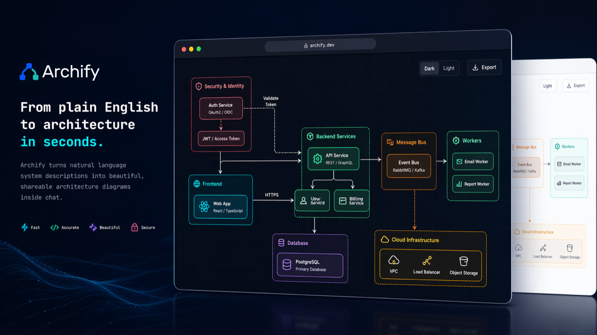</p>

## 看看 V-Diagram 能做什么

<!-- v-diagram-launch-video -->

https://github.com/user-attachments/assets/88cff7dd-bdf3-4b97-950c-37cc079898b1

<p align="center"><sub>35 秒演示：探索交互图、查看源码关联、追踪完整路径。</sub></p>

## 为什么用 V-Diagram

| 🗺️ 读懂结构 | 🧭 边看边讲 | 🧩 易于扩展 | 📤 方便交付 |
|---|---|---|---|
| 从代码或一段描述出发，整理关键组件、流程和关系。 | 点击节点、追踪路径、把任意视图分享成链接。 | 保留可编辑的 Typed Source，也可基于开源代码和生成的 HTML 扩展。 | 一个独立 HTML 文件，或导出图片、视频与分享卡片。 |

## 预览

<details>
<summary><strong>深浅主题、导出菜单与分享卡片</strong></summary>

<br />

同一张图，两套主题，一键切换：

| 深色 | 浅色 |
|---|---|
| 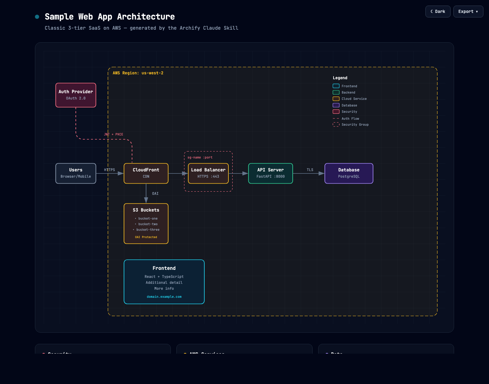 | 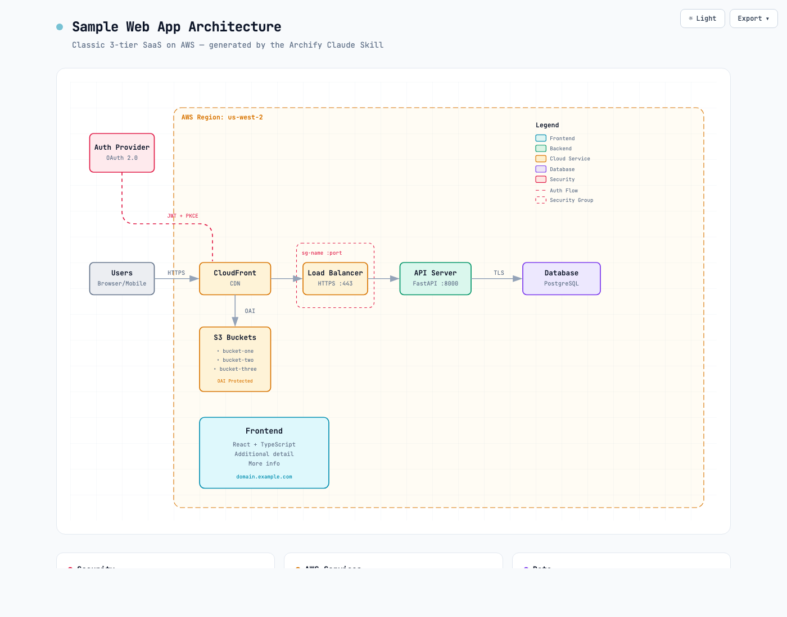 |

Export 菜单支持复制 PNG，并下载静态或动态格式：

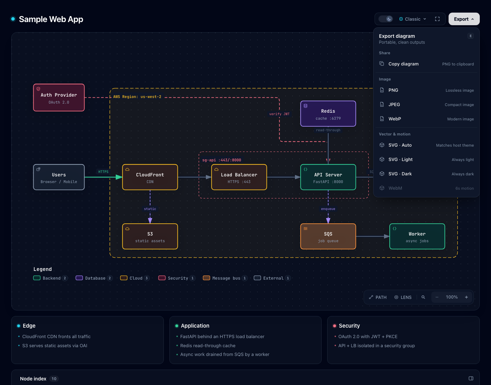

路径解析后，**Export → Route Share Card** 会把真实路径下载为 1200×630 PNG，并保留完整拓扑上下文。

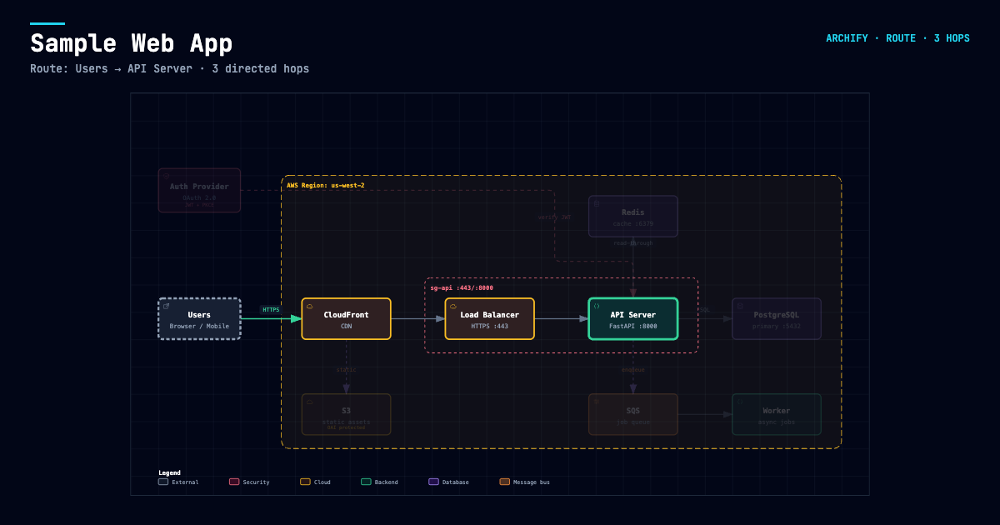

完成 authored `Upstream` 或 `Downstream` reach 后，**Export → Reach Share Card** 会捕获这次阅读结果，但不冒充运行时影响分析。

在本地打开 [`examples/web-app.html`](examples/web-app.html)，即可体验完整 Viewer。

</details>

---

<a id="start"></a>

## 快速开始

**1. 安装**（Cursor、Claude Code、Codex CLI、OpenCode）：

```bash
npx skills add mbnetworku/V-Diagram -g
```

**2. 告诉你的 Agent。** 不需要绑定代码库：

```text
用 V-Diagram 画出一个网站的请求流程：浏览器请求 API，
API 优先读取 Redis，缓存未命中时查询 PostgreSQL 并回填缓存。
```

**3. 在对话中细调。** 继续说“添加鉴权步骤”“突出缓存未命中的路径”“切换浅色主题”。V-Diagram 会保留 Typed Source，只修改相关部分。

需要源码证据时，打开仓库后改用：

```text
分析这个仓库，然后使用 v-diagram 生成一张高层运行时架构图。
只保留 8–12 个核心组件，突出一条主要路径，并标出外部依赖与信任边界。
辅助信息放进说明卡片，不要继续增加连线。
```

<a id="quick-start"></a>

<details>
<summary><strong>更多安装方式、更新检查与获取更新</strong>（当前稳定版本：<code>v3.2.0</code>）</summary>

<br />

显式、非交互地安装到 Cursor：

```bash
npx -y skills add mbnetworku/V-Diagram --skill v-diagram --agent cursor --global --copy --yes
```

如果只想临时体验：

```bash
npx skills use mbnetworku/V-Diagram@v-diagram --agent codex
```

**更新检查。** V-Diagram 可能会请求固定的稳定版清单，仅用于显示可选的更新提醒；它绝不会下载或安装更新。一次成功检查后，下次通常约在 24 小时（±20%）后进行；检查失败时，活跃使用会在 6 小时、之后 24 小时重试。服务端只会看到常规 HTTP 元数据（IP 和时间），不会收到版本、Agent、项目数据、提示词、账户/设备标识或 ETag。是否更新、何时更新由你决定。设置 `VDIAGRAM_UPDATE_CHECK_DISABLED=1` 可关闭网络请求和提醒状态的写入。

**获取更新。**

- **订阅新版本：** 在本 GitHub 仓库顶部选择 **Watch → Custom → Releases**。点 Star 不会自动订阅版本发布通知。
- **查看更新内容：** [版本说明](https://github.com/mbnetworku/V-Diagram/releases)和[版本历史](CHANGELOG.md#320--2026-10-18)。
- **使用 RSS 阅读器：** [订阅版本更新源](https://github.com/mbnetworku/V-Diagram/releases.atom)。

带有更新检查器的安装版本，也会在交付图时检查新的稳定版，并可显示提醒。不带检查器的旧安装需要先手动更新，才能获得这项功能。V-Diagram 不会自动安装更新。

</details>

---

<a id="what-you-can-make"></a>

## 能做出什么

### 一页式解答

让 Agent 用一页来回答，V-Diagram 会生成一份 **explainer**：先给结论，再按问题分成几个面板，用表格、步骤、图表、代码和经过校验的图把理由讲清楚。

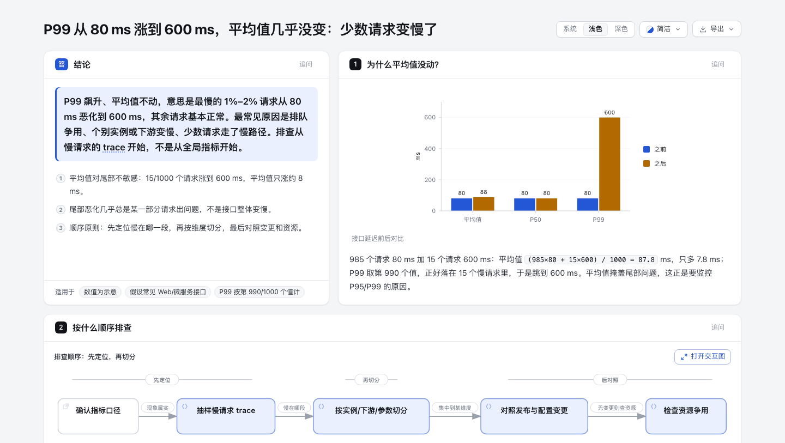

| | |
|---|---|
| **结论先行** | 先写答案和理由，每个面板只回答一个问题。 |
| **图和文字一起讲** | 步骤放在它讲解的图旁边，读到哪一步，图上就亮起哪一部分。 |
| **能核对** | 结论标注编号来源；仓库代码固定到具体提交。 |
| **好分享** | 一个 HTML 文件，四种样式，浅色深色都有；可导出 PNG、WebP、JPG 或 PDF。 |

```text
用 V-Diagram 一页回答：接口 P99 从 80 ms 涨到 600 ms，平均值几乎没变，
可能是什么原因，应该怎么排查？
```

### 突出重点的视图

| 讲清 Agent 如何调用工具 | 跟随一次缓存回源请求 | 看清服务与数据库的关系 |
|---|---|---|
| 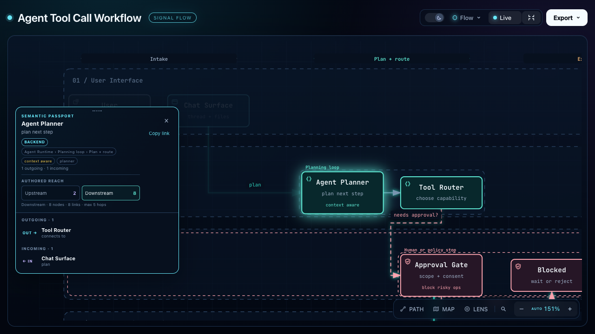 | 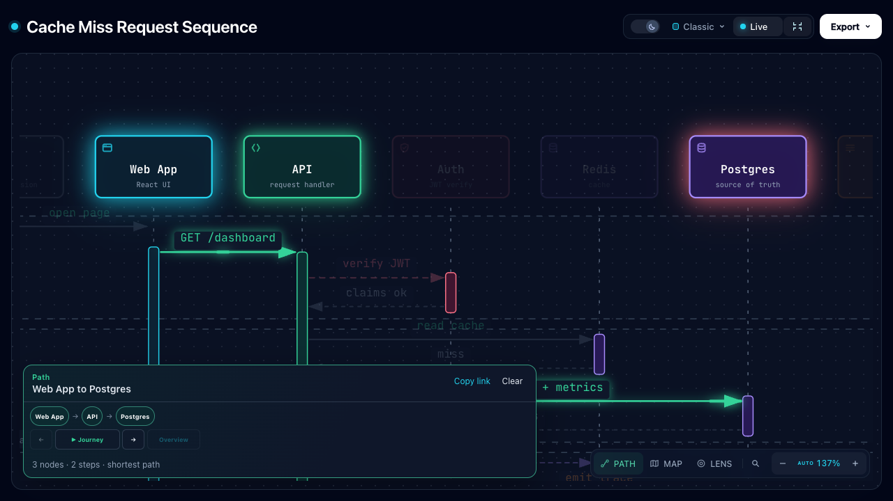 | 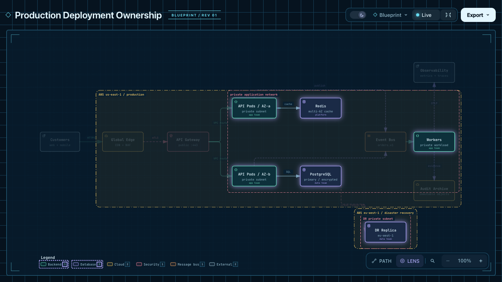 |
| 追踪一个步骤影响到的全部下游。 | 点亮 Web App 到数据库的路径。 | 聚焦后端与数据库之间已定义的连接。 |

[Proof Lab](https://mbnetworku.github.io/V-Diagram/zh/gallery) 收录全部 11 个仓库内场景、JSON 源和校验回执。

---

<a id="diagram-types"></a>

## 图表类型

| 类型 | 最适合 | Prompt 中应包含 |
|---|---|---|
| **Architecture** | 组件、服务、存储和系统边界 | 范围、核心组件、主要路径 |
| **Workflow** | CI/CD、审批、工具调用、Runbook | 参与者、顺序、分支、异常 |
| **Sequence** | API 调用、缓存回源、鉴权、异步链路 | 调用方、被调用方、返回、时序 |
| **Data Flow** | 数据管线、血缘、PII、下游消费者 | 来源、转换、存储、边界 |
| **Lifecycle** | 状态、重试、等待、终态 | 状态、事件、重试与取消路径 |
| **ERD** | 数据库结构：表、字段、键、基数关系 | 表、每个字段及类型、键、关系基数 |
| **Class** | 类、接口、关键成员与类型关系 | 类型、关键成员、继承、组合与依赖 |
| **Tree** | 单一父级的层级结构：仓库、模块、能力拆解 | 根节点、层级、各分支包含的内容 |
| **Timeline** | 何时发生了什么：故障复盘、发布历史 | 带时区的时间点、事件、来源泳道 |
| **Waterfall** | 一次请求或 Agent 运行的耗时分布 | Span、开始时间与时长、嵌套关系 |

不知道选哪一种？打开[交互式场景指南](https://mbnetworku.github.io/V-Diagram/zh/guide)，或直接询问零依赖 CLI：

```bash
node v-diagram/bin/v-diagram.mjs guide "展示带 Redis 缓存未命中的 API 请求"
node v-diagram/bin/v-diagram.mjs guide "梳理 Kafka Topic、消费者组、重放和死信队列" --json
```

<details>
<summary><strong>查看每种图表的示例</strong></summary>

<br />

| Workflow | Sequence | Data Flow |
|---|---|---|
| 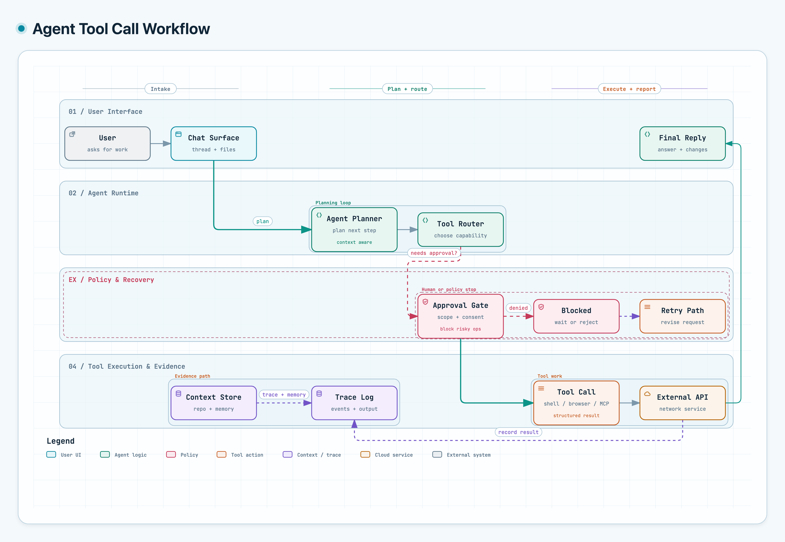 | 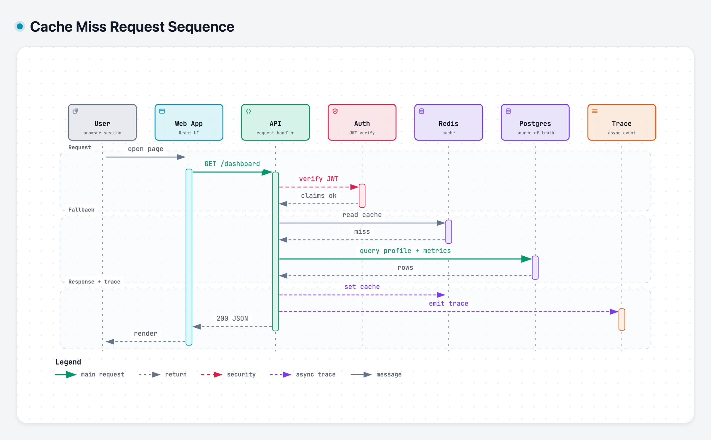 | 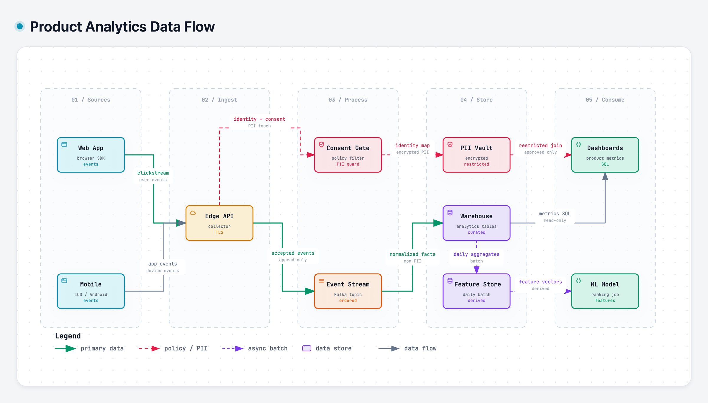 |
| 用泳道保持主路径清晰。 | 解释一次交互随时间如何推进。 | 突出数据移动和敏感边界。 |

| Lifecycle | ERD | Class |
|---|---|---|
| 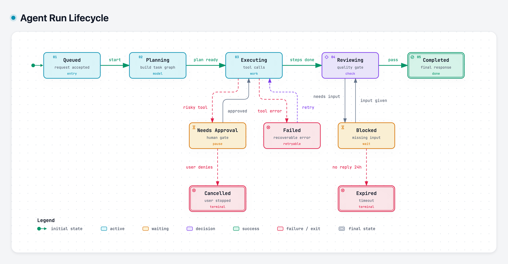 | 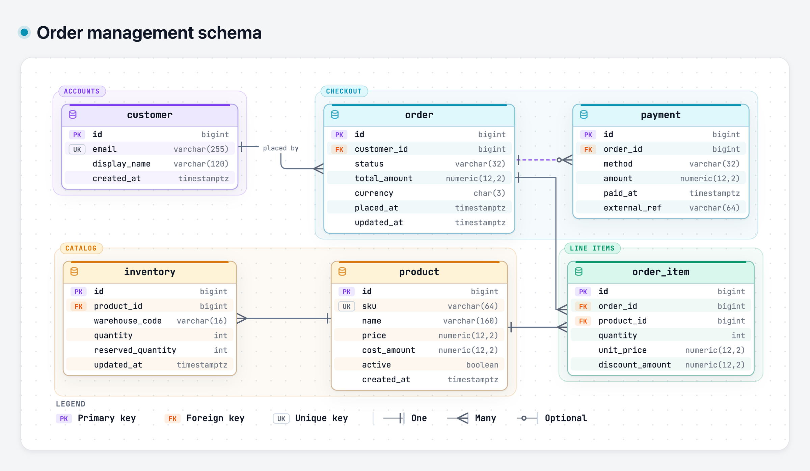 | 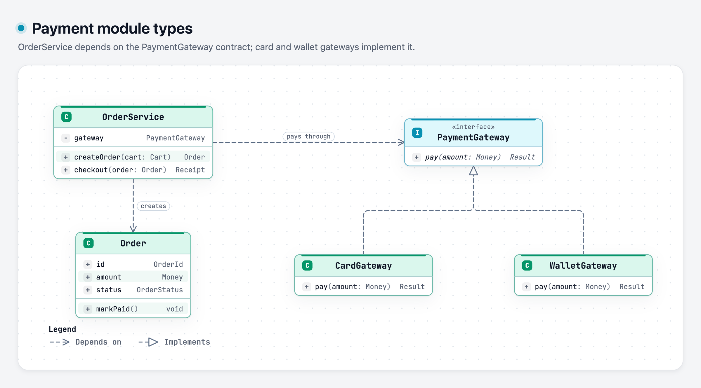 |
| 区分正常进展、等待、重试和终态。 | 把表、字段、键与关系基数放在一起。 | 展示接口契约、关键成员与依赖。 |

| Tree | Timeline | Waterfall |
|---|---|---|
| 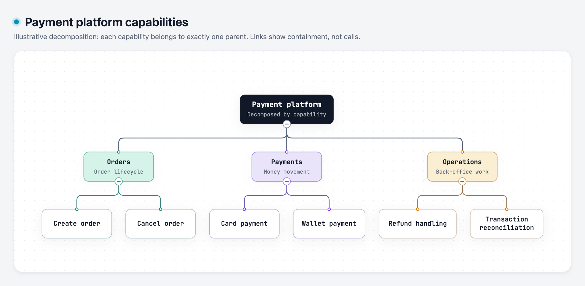 | 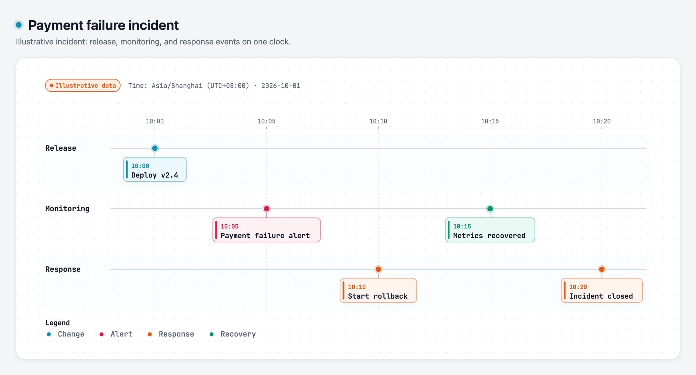 | 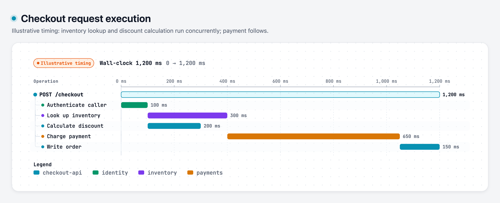 |
| 单一父级的包含关系。 | 事件放在同一条按比例的时间轴上。 | 嵌套、重叠的 Span。 |

ERD、Class、Tree、Timeline 和 Waterfall 于 3.1 新增。其中 Timeline 和 Waterfall 示例使用示意数据；只有来自日志或链路追踪的时间和耗时，才能当作真实数据。

**打开示例：** [`ERD`](https://mbnetworku.github.io/V-Diagram/gallery/artifacts/orders.erd.html) · [`Class`](examples/class-payments-rendered.html) · [`Tree`](examples/tree-payment-platform-rendered.html) · [`Timeline`](examples/timeline-payment-incident-rendered.html) · [`Waterfall`](examples/waterfall-checkout-request-rendered.html)

**Architecture 示例：** [`Web App`](examples/web-app.html) · [`V-Diagram Pipeline`](examples/v-diagram-repo.html) · [`Grid 布局`](examples/v-diagram-repo-grid.html) · [`桌面 Agent`](examples/maka-architecture.html)

</details>

<details>
<summary><strong>Architecture 工程画像与评审（Delta）</strong></summary>

<br />

做生产部署评审时，Architecture 可以按需启用 `deployment-ownership` 工程画像：负责人、单一区域归属、数据库私有边界或边界穿越机制缺失时会直接阻断。它不会被静默开启，只校验作者写入的事实，不代表线上基础设施已经核验。可查看[通过校验的部署证明](https://mbnetworku.github.io/V-Diagram/zh/gallery#proof-deployment-ownership)。

做设计或 PR 评审时，Architecture Delta 生成已校验的 Before / Delta / After 和机器回执。精确选择任一作者变更，或播放一次有限 Review；全程只读，不推断影响、风险或合并安全。

```bash
node v-diagram/bin/v-diagram.mjs compare architecture base.json head.json architecture-delta.html --json
```

[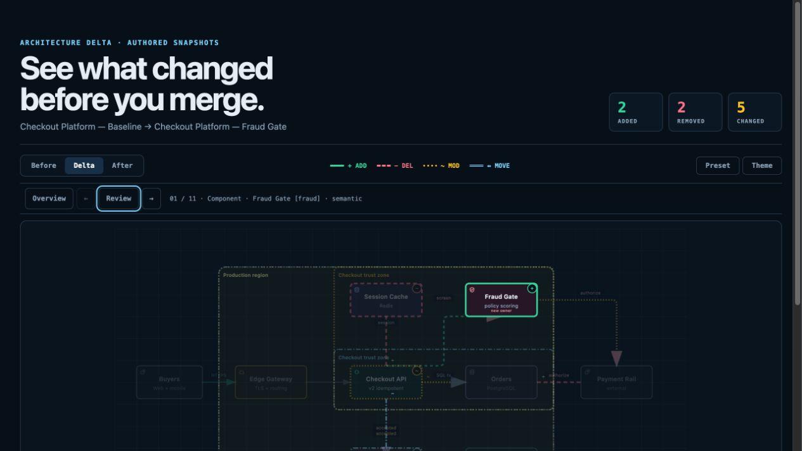](examples/checkout-platform-delta.html)

</details>

---

<a id="explore-and-share"></a>

## 探索与分享

每份成品都是独立的 HTML Viewer。快捷键与控制方式：

| 操作 | 控制方式 |
|---|---|
| 打开事实型 Diagram Guide | <kbd>?</kbd> |
| 查找并聚焦语义节点 | <kbd>/</kbd> |
| 追踪作者定义的上游 / 下游可达范围 | 聚焦节点 → `Upstream` / `Downstream` |
| 探查有向路径并逐站检查 | <kbd>R</kbd> 或“路径” |
| 对比一种或两种语义角色 | <kbd>L</kbd> 或“透镜” |
| 打开实时全局雷达 | <kbd>M</kbd> 或“地图” |
| 进入 Presentation Stage | <kbd>F</kbd> |
| 选择视觉风格 / 切换主题 / 打开 Export | <kbd>S</kbd> / <kbd>T</kbd> / <kbd>E</kbd> |
| 缩放或复位 | <kbd>+</kbd> / <kbd>-</kbd> / <kbd>0</kbd> |

稳定链接可以恢复 `#focus=<id>`、`#focus=<id>&reach=upstream|downstream`、`#relation=<id>`、`#route=<source>~<target>` 和 `#lens=<kind>~<kind>`。动效遵守 `prefers-reduced-motion`，并且不会进入标准导出。

---

## 工作原理

| 步骤 | 发生什么 |
|---|---|
| **1 · 生成** | Agent 根据描述创建 Typed JSON IR。 |
| **2 · 校验** | 内置 Validator 和布局规则检查源文件；失败时用机器可读 JSON 指出准确的局部修复。 |
| **3 · 预览**（可选） | 仅 loopback 的桌面会话监听一个源文件，只刷新验证版本；失败时保留最后好图。 |
| **4 · 交付** | 在目标同目录生成并检查候选；只有通过门禁的结果才原子替换目标文件。 |
| **5 · 迭代** | Agent 修改源文件，不干扰无关结构。 |

<details>
<summary><strong>工程细节</strong></summary>

<br />

- **用布局判断代替通用自动布局** —— Agent 根据故事选择层级、留白、线路和强调关系；共享的自动端点会确定性展开，不再让多支箭头堆在同一个中点。
- **Typed JSON IR** —— 每种 Renderer 模式都有 Schema 和可复现的源文件。
- **原子交付前校验** —— Schema、布局、HTML/SVG、线路和标签到其他路径的净空检查必须全部通过，Showcase 成品才会替换上一份可信结果。
- **失败也有结构化修复回执** —— `validate --json` 和 `deliver --json` 会返回稳定规则码、准确对象、测量证据和真正支持的修复旋钮，不再让 Agent 从 Node 堆栈或自由文本里猜。
- **保留最后好图的实时预览** —— 可选桌面循环只监听一个 JSON；只有最新候选通过全部门禁才刷新，半写入或无效保存时继续显示上一份验证成品。
- **交互不编造拓扑** —— 聚焦、上下游可达范围、精确路径、角色对比和故事都复用作者定义的节点与关系，也不把图上可达误报成真实运行时影响。
- **只在需要时附源码证据** —— 有证据的 Architecture 节点会显示 `SRC n`，并可打开由 Git 校验、固定到公开 commit 的文件与行号；普通成品不携带源码信息。
- **结果默认便携** —— 一个 HTML 文件即可分享；导出永远是完整原图，不携带临时 Viewer 状态。

V-Diagram 不是通用绘图编辑器，也不是 Mermaid 主题；它负责把技术意图变成可交流的成品。

</details>

<details>
<summary><strong>命令行参考与设置</strong></summary>

<br />

```bash
cd v-diagram
node bin/v-diagram.mjs doctor
node bin/v-diagram.mjs demo /tmp/v-diagram-demo
node bin/v-diagram.mjs guide "展示 CI/CD 检查、审批、部署和回滚"
node bin/v-diagram.mjs validate workflow examples/agent-tool-call.workflow.json --quality showcase --json
node bin/v-diagram.mjs preview workflow examples/agent-tool-call.workflow.json /tmp/workflow.html --quality showcase
node bin/v-diagram.mjs deliver workflow examples/agent-tool-call.workflow.json /tmp/workflow.html --quality showcase --open --json
```

`preview` 是显式启用的桌面创作模式，不是默认后台服务：它只在随机端口监听 `127.0.0.1`，只观察指定 JSON，失败时保留上一份验证输出，并通过 Ctrl-C 停止。测试或准备手动打开打印出的本地 URL 时可加 `--no-open`。生成的 HTML 不会携带 Preview Runtime。

`deliver --open` 适合一次性的本地交互交付。它默认关闭，并且只在验证成品原子提交后执行；系统无法打开时，交付仍保持成功，JSON 只写 stdout，stderr 会给出可手动打开的绝对路径。

失败时，`validate --json` 和 `deliver --json` 仍然只输出一个 JSON 对象。读取 `diagnostics[]`，只修改其中 `subject` 指向的对象，并使用 `supportedFixes` 列出的修复方式，且不要突破 Skill 最多两轮的聚焦修复上限；视觉复核仍是单独的步骤。

设置：

```json
{
  "meta": {
    "locale": "zh-CN",
    "animation": "trace",
    "visual_preset": "signal-flow"
  }
}
```

`meta.locale` 会本地化页面标题、图例、状态/错误文案、无障碍文案和 HTML/SVG 的 `lang`，但绝不会翻译作者编写的内容。`en`、`zh-CN`、`zh-TW`、`es`、`ko` 与 `ar` 已内置，只需设置 `meta.locale`；`meta.translations`（规范消息键到译文字符串的映射）可逐键覆盖，其余文案保持所选语言。其他语言需在该字段中提供完整目录（参见 `v-diagram/examples/locales/`），否则渲染器回退为英文并给出说明。不设置 `animation` 时结果完全静态；`classic` 始终是默认视觉预设。

</details>

---

<a id="installation-options"></a>

## 安装方式

| 使用位置 | 安装位置或方法 | 能力 |
|---|---|---|
| **Claude Code** | `~/.claude/skills/` 或 `.claude/skills/` | 完整 Renderer + Validation 工作流 |
| **Codex CLI** | `~/.agents/skills/` 或 `.agents/skills/` | 完整 Renderer + Validation 工作流 |
| **opencode** | `~/.config/opencode/skills/`、`.opencode/skills/` 或 `.agents/skills/` | 完整 Renderer + Validation 工作流 |
| **Claude.ai** | Settings → Capabilities → Skills 中上传 `v-diagram.zip` | 取决于沙箱是否提供 Node.js |
| **Project Knowledge** | 把 `v-diagram.zip` 上传到项目 | Prompt 驱动的 Architecture Fallback |

[Agent 切换器](https://mbnetworku.github.io/V-Diagram/zh/start?agent=cursor&type=architecture)会为 `cursor`、`codex`、`claude-code` 和 `opencode` 生成安装命令。

## 文档

- [Skill 与 Viewer 契约](v-diagram/SKILL.md) —— 完整的生成与 Viewer 参考
- [Schema 说明](v-diagram/schemas/README.md) · [示例](v-diagram/examples/) · [Agent 编图手册](docs/authoring-cookbook.zh-CN.md)（[English](docs/authoring-cookbook.md)）
- [版本历史](CHANGELOG.md) · [Proof Lab](https://mbnetworku.github.io/V-Diagram/zh/gallery) · [场景指南](https://mbnetworku.github.io/V-Diagram/zh/guide)

自动 Mermaid Parser、通用自动布局、托管分享服务和 WYSIWYG 编辑器目前都不在产品范围内。

---

<a id="contributing"></a>

## 参与贡献

欢迎提交 Issue、Pull Request 和真实场景图。请先阅读[贡献指南](CONTRIBUTING.md)；遇到问题时使用可复现 Bug 表单，也可以通过[社区 Showcase 表单](https://github.com/mbnetworku/V-Diagram/issues/new?template=showcase.yml)提交已验证成品。

## 许可证

[Apache-2.0](LICENSE) —— 可以自由使用、修改和分发。

历史 MIT 授权继续有效，见 [NOTICE](NOTICE) 和 [LICENSE-MIT](LICENSE-MIT)。第三方组件保留各自许可；软件许可不改变用户原创内容的权属，也不授予一般性的 V-Diagram 商标使用权。

## 致谢与声明

<sub>V-Diagram 是 tt-a1i 开发的 [Archify](https://github.com/tt-a1i/archify) 的修改版本，依据 [Apache License 2.0](LICENSE) 使用。原版权声明保留在 [NOTICE](NOTICE) 和 [LICENSE-MIT](LICENSE-MIT) 中。V-Diagram 独立维护，与 Archify 作者无关联，也未获其背书。</sub>
